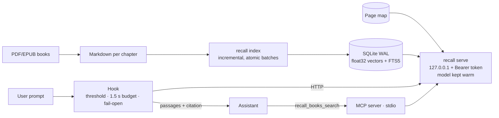

# recall


Local, bilingual semantic search over a library of technical books, built for
a **coding assistant** (Claude Code and Claude Desktop). Ask in Spanish or
English; recall finds the right passage in English books and hands it to the
assistant **with its citation** (book, chapter, page).

It works in two ways: a **hook** that quietly adds the relevant passages to a
prompt when — and only when — they clear a similarity threshold, and an **MCP
tool** the assistant calls when it wants to search on its own.

> 🔒 **Local retrieval.** Indexing and search never touch the network: the
> embedding model runs from a local snapshot on your GPU, `HF_HUB_OFFLINE=1` is
> set on import, and `huggingface-hub` is not even installed. The search
> service listens only on `127.0.0.1` behind a random token. **The passages
> recall injects do become part of your prompt**, so they reach whatever
> provider runs your assistant — index only documents you are willing to
> share with it.
>
> 📚 **Bring your own books.** The repository contains no book content — only
> the code, bibliographic metadata and the evaluation queries. You index your
> own Markdown-converted library.

📖 **New here? Start with the [User Manual](docs/USAGE.md)**: setup, indexing,
connecting Claude Code and Desktop, configuration and troubleshooting. The
study behind the current configuration is in the **[paper](docs/paper.md)**.

## Contents

- [Why](#why) · [Quickstart](#quickstart) · [How it works](#how-it-works)
- [Components](#components) · [Results](#results) · [Commands](#command-reference)
- [Configuration](#configuration) · [Security model](#security-model)
- [Status](#status) · [Documentation](#documentation) · [License](#license)

## Why

A coding assistant answers from memory. When you own a shelf of good books on
architecture, data, SRE, security or testing, you want it to **cite them**
instead — and you want that to happen without asking every time, and without
noise when the books have nothing to say. That last part is the hard one:
automatic injection needs an **absolute score** that says "this is relevant
enough", not just a ranking. recall is built around that score.

## Quickstart

```powershell
# 1. Locked environment (Python 3.12, win/amd64, hashes pinned)
uv venv --python 3.12
uv pip sync requirements.lock

# 2. Index your library (Markdown, one file per chapter; incremental)
.venv\Scripts\python.exe -I -m recall index

# 3. Search from the command line — Spanish and English in one call
.venv\Scripts\python.exe -I -m recall search "tasa de consumo del presupuesto de errores" "error budget burn rate" --text

# 4. Check the index and the service
.venv\Scripts\python.exe -I -m recall status
```

Then wire it into Claude Code and Desktop (MCP server + hooks) following the
[User Manual](docs/USAGE.md).

## How it works



Three principles keep it useful and out of the way:

1. **Absolute scores.** Search returns the raw cosine between question and
   passage. The hook injects only above a calibrated threshold, so unrelated
   prompts ("make the README title bold") get nothing.
2. **Fail open.** The hook has a 1.5 s budget. On any error, timeout or low
   score, the prompt goes through unchanged. It starts in **shadow mode**:
   it logs what it *would* have injected (a hash of the prompt, never its
   text) so the threshold can be calibrated on real use before switching on.
3. **The index knows its model.** Model files, prefixes and chunking are part
   of the index identity. Searching with a different model is an explicit
   error, never silently wrong results.

More diagrams (sequences, trust boundaries): [docs/DIAGRAMS.md](docs/DIAGRAMS.md).

## Components

| Piece | What it does |
|---|---|
| `recall index` | Splits the Markdown chapters by section into chunks and stores text + vector in SQLite. Incremental: only changed chapters are reprocessed, and any already-embedded text reuses its vector. |
| `recall serve` | Local service with the model loaded (DirectML GPU, CPU fallback). Hybrid search: vector first, fused with FTS5 via RRF, deduplicated by section. |
| `recall_hook.py` | `UserPromptSubmit` hook. Skips trivial or mechanical prompts, searches, and injects up to 3 passages above the threshold, trimmed to the window that best matches the question. Standard library only. |
| `recall mcp` | Dependency-free MCP server exposing `recall_books_search` (Spanish + English queries in one call, filters by topic domain and publication year). |
| `start-recall.ps1` | `SessionStart` hook: starts the service detached if it isn't healthy; always exits 0. |
| `data/books_meta.json` | Year (from the copyright page), edition, format and topic domains for each book. |
| `tools/build_pages.py` | Maps each Markdown line to its printed PDF page, for citations like "p. 199". |
| `tools/verify_index.py` | Read-only integrity verifier for any index. |
| `tools/shadow_report.py` | Summarizes the shadow log: how many real prompts each candidate threshold would inject. |
| `experiments/` | Indexes another model or chunking into its own directory and compares it with production. |

## Results

Measured on 126 books (3,184 chapters) with 80 hand-labeled queries (40 Spanish,
40 English) and 28 negative prompts. Full study: [docs/paper.md](docs/paper.md).

| Configuration | Chunks | R@5 | R@5 ES→EN | MRR@10 | Separation |
|---|---|---|---|---|---|
| Baseline: embeddinggemma-300m, ~900 chars | 111,407 | 0.975 | 0.975 | 0.883 | 0.944 |
| **Production (E5): embeddinggemma-2, ~3,500 chars** | **34,721** | **0.988** | **0.975** | **0.898** | **1.000** |

*Separation* is the share of relevant queries scoring above the highest
unrelated prompt; 1.0 means a threshold exists that accepts all of them and
rejects every negative. Production uses a threshold of 0.75: 96.7 % of relevant
queries pass and none of the negatives. Search latency is ~0.13 s (median) and
the full hook round trip 0.4–0.6 s.

The study also documents that the quantized ONNX export of Qwen3-Embedding-0.6B
is **not padding-invariant** — a vector changes with whatever else shares its
batch — which the integrity verifier caught before evaluation.

## Command reference

| Command | What it does |
|---|---|
| `recall index [--rebuild] [--root DIR] [--dml-device N] [--cpu]` | Index the library (incremental). |
| `recall search QUERY... [-k N] [--text]` | Search with one or more phrasings. |
| `recall serve` | Run the local search service. |
| `recall mcp` | Run the MCP server over stdio. |
| `recall status` | Show index and service state. |
| `recall eval [--queries FILE] [--out FILE]` | Regression metrics (R@5, MRR@10). |
| `tools\verify_index.py [HOME...] [--sample N] [--sample-cpu] [--no-source]` | Verify index integrity, read-only. |
| `tools\shadow_report.py [--log FILE] [--since DATE]` | Shadow-mode summary for threshold calibration. |
| `experiments\run.ps1 [-Only NAME...]` | Build experiment indexes without touching production. |
| `experiments\evaluate.py` | Compare production and experiments on the 80 queries. |

Run everything with the project interpreter in isolated mode:
`.venv\Scripts\python.exe -I -m recall …`.

## Configuration

State lives in `%LOCALAPPDATA%\recall` (override with `RECALL_HOME`): the index,
`service.json` (port and token), `shadow.log`, and an optional `config.json`:

```json
{
  "collections": {"books": {"roots": ["C:\\Users\\<user>\\Downloads\\Books TI\\_md"]}},
  "chunking": {"target": 3200, "max_chars": 3500, "min_chars": 1500, "overlap": 400},
  "model": {"name": "onnx-community/embeddinggemma-2-ONNX", "snapshot": "<local snapshot dir>",
            "doc_max_tokens": 1100, "batch_size": 8},
  "hook": {"mode": "shadow", "threshold": 0.75}
}
```

| Key | Default | Purpose |
|---|---|---|
| `collections.books.roots` | `~\Downloads\Books TI\_md` | Library roots, in precedence order (a book in an earlier root replaces the same book in a later one). |
| `chunking` | ~900 chars | Chunk target, limits and overlap. Part of the index identity. |
| `model` | embeddinggemma-300m | Model name, snapshot, prefixes, pooling. Part of the index identity. |
| `hook.mode` | `shadow` | `shadow` (log only) or `active` (inject). |
| `hook.threshold` | per model | Minimum cosine to inject. Recalibrate whenever the model changes. |

The code defaults are the **baseline** configuration, so existing indexes
keep working. To use the configuration measured as best (E5), start from
[`config.example.json`](config.example.json): copy it to
`%LOCALAPPDATA%\recall\config.json`, point `snapshot` at your local
embeddinggemma-2 download, and run `recall index --rebuild`.

Changing `chunking` or `model` requires `recall index --rebuild`. Full
reference: [User Manual](docs/USAGE.md).

## Security model

- **Local only**: `127.0.0.1`, ephemeral port, random Bearer token compared in
  constant time; no network calls anywhere.
- **Read-only search**: the service and the MCP server open the index read-only.
- **Passages are data**: injected passages are wrapped in a block that marks
  them as reference data, not instructions; every field taken from the index
  (text, headings, path) has its `<`/`>` neutralized so it cannot close that
  block, and paths are cited relative to the library.
- **Pinned supply chain**: every dependency hash-pinned in `requirements.lock`;
  `huggingface-hub` excluded on purpose.

Full analysis: [docs/THREAT_MODEL.md](docs/THREAT_MODEL.md). **Found a
vulnerability?** Report it privately — see [SECURITY.md](SECURITY.md).

## Status

**Alpha**, in daily use on one machine (Windows 11, DirectML). The index,
service, hook, MCP server, page citations and filters are in place; the hook
runs in shadow mode while its threshold is calibrated on real prompts.

The unit suite (137 tests, no model needed) runs in CI on Windows. The
regression suite (`pytest -m model`) needs the real model and a full index and
runs locally, with floors set to the measured production numbers — see
[docs/TESTING.md](docs/TESTING.md).

## Documentation

- [User Manual](docs/USAGE.md) — setup, indexing, Claude Code/Desktop, configuration, troubleshooting
- [Paper](docs/paper.md) — chunking and model study, evaluation, rollout
- [Architecture](docs/ARCHITECTURE.md) — components, data flow, invariants
- [Diagrams](docs/DIAGRAMS.md) — context, sequences, trust boundaries
- [Architecture Decision Records](docs/adr/README.md)
- [Threat model](docs/THREAT_MODEL.md) — STRIDE analysis
- [Testing](docs/TESTING.md) — unit suite, model regression, integrity checks
- [Adversarial review](docs/ADVERSARIAL_REVIEW.md) — red-team pass
- Audit reports: [`audits/`](audits/)
- [Security policy](SECURITY.md) · [Contributing](CONTRIBUTING.md) ·
  [Code of Conduct](CODE_OF_CONDUCT.md) · [Changelog](CHANGELOG.md)

## License

Apache-2.0. See [LICENSE](LICENSE) and [NOTICE](NOTICE). Embedding models are
downloaded separately and keep their own licenses.
