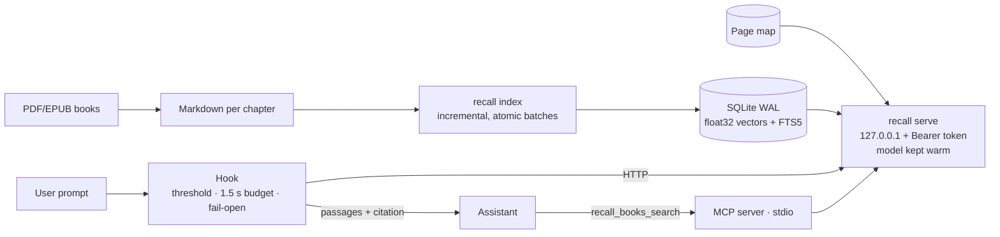

# recall

[](https://github.com/andreshma/recall/actions/workflows/ci.yml)
[](https://github.com/andreshma/recall/actions/workflows/codeql.yml)
[](LICENSE)
[](pyproject.toml)


Local, bilingual semantic search over a library of technical books, built for
a **coding assistant** (Claude Code and Claude Desktop). Ask in Spanish or
English; recall finds the right passage in English books and hands it to the
assistant **with its citation** (book, chapter, page).

It works in two ways: a **hook** that quietly adds the relevant passages to a
prompt when — and only when — they clear a similarity threshold, and an **MCP
tool** the assistant calls when it wants to search on its own.

> **Local retrieval.** Indexing and search never touch the network: the
> embedding model runs from a local snapshot on your GPU, `HF_HUB_OFFLINE=1` is
> set on import, and `huggingface-hub` is not even installed. The search
> service listens only on `127.0.0.1` behind a random token. **The passages
> recall injects do become part of your prompt**, so they reach whatever
> provider runs your assistant — index only documents you are willing to
> share with it.
>
> **Bring your own books.** The repository contains no book content — only
> the code, bibliographic metadata and the evaluation queries. You index your
> own Markdown-converted library.

**New here? Start with the [User Manual](docs/USAGE.md)**: setup, indexing,
connecting Claude Code and Desktop, configuration and troubleshooting. The
study behind the current configuration is in the **[paper](docs/paper.md)**.

## Contents

- [Why](#why)
- [Quickstart](#quickstart)
- [How it works](#how-it-works)
- [Components](#components)
- [Usage](#usage)
- [Results](#results)
- [Configuration](#configuration)
- [Security model](#security-model)
- [Testing](#testing)
- [Status](#status)
- [Documentation](#documentation)
- [Community](#community)
- [License](#license)

## Why

A coding assistant answers from memory. When you own a shelf of good books on
architecture, data, SRE, security or testing, you want it to **cite them**
instead — and you want that to happen without asking every time, and without
noise when the books have nothing to say. That last part is the hard one:
automatic injection needs an **absolute score** that says "this is relevant
enough", not just a ranking. recall is built around that score.

## Quickstart

Windows 10/11 x64, Python 3.12 and [uv](https://docs.astral.sh/uv/), in
PowerShell (Windows PowerShell 5.1 or pwsh 7).

### 1. Install

Install the locked environment (every package hash-pinned) plus recall itself,
so that `python -I -m recall` works. CI runs the second block verbatim on every
push.

```powershell
git clone https://github.com/andreshma/recall.git
cd recall
```

<!-- quickstart-install -->
```powershell
uv venv --python 3.12 .venv
uv pip sync --require-hashes --python .venv\Scripts\python.exe requirements.lock
uv pip install --no-deps --no-build-isolation --python .venv\Scripts\python.exe -e .
.venv\Scripts\python.exe -I -m recall --help
```

Run the `uv pip install ... -e .` line again after any later `uv pip sync`
(sync removes packages that are not in the lock, recall included).

### 2. Get the embedding model

recall never downloads anything. Fetch an
ONNX snapshot once, with any tool you like and outside recall's environment —
for example `git clone https://huggingface.co/onnx-community/embeddinggemma-300m-ONNX`
with Git LFS installed (accept the model's license on its page first; the
Gemma models are gated). The folder must contain `onnx/model_quantized.onnx`
(plus its `.onnx_data`, if any) and `tokenizer.json`; its name is recorded as
the revision. Point `model.snapshot` in `%LOCALAPPDATA%\recall\config.json` at
it ([USAGE §2.2](docs/USAGE.md#22-embedding-model)); the recommended model and
settings are in [`config.example.json`](config.example.json).

### 3. Point recall at your library

The library is Markdown, one file per chapter, one
folder per book ([input contract](docs/USAGE.md#4-prepare-the-library)). The
default root is `%USERPROFILE%\books\md`; set `collections.books.roots` in the
same `config.json` to use another folder.

### 4. Index, search, check

```powershell
.venv\Scripts\python.exe -I -m recall index     # incremental; the first full run takes hours
.venv\Scripts\python.exe -I -m recall search "tasa de consumo del presupuesto de errores" "error budget burn rate" --text
.venv\Scripts\python.exe -I -m recall status
```

Then wire it into Claude Code and Desktop (MCP server + hooks) following the
[User Manual](docs/USAGE.md#7-connect-claude-code).

## How it works

The diagram follows a book from its Markdown chapters to the passages the assistant receives.



Three principles keep it useful and out of the way:

1. **Absolute scores.** Search returns the raw cosine between question and
   passage. The hook injects only above a calibrated threshold, so unrelated
   prompts ("make the README title bold") get nothing.
2. **Fail open.** The hook has a 1.5 s budget. On any error, timeout or low
   score, the prompt goes through unchanged. It starts in **shadow mode**:
   it logs what it *would* have injected (a hash of the prompt, never its
   text) so the threshold can be calibrated on real use before switching on.
3. **The index knows its model.** Model files, prefixes and chunking are part
   of the index identity. Searching with a different model is an explicit
   error, never silently wrong results.

The four flows behind the diagram — the indexing pipeline, search inside the service, automatic injection
(hook) and explicit search (MCP) — are described step by step, each with its diagram, in
[docs/architecture.md](docs/architecture.md#flows). Every diagram of the project (context, components,
sequences, trust boundaries) is in [docs/DIAGRAMS.md](docs/DIAGRAMS.md).

## Components

| Component | What it does | Where |
|---|---|---|
| `recall index` | Splits the Markdown chapters by section into chunks and stores text + vector in SQLite. Incremental: only changed chapters are reprocessed, and any already-embedded text reuses its vector. | `src/recall/indexer.py`, `chunking.py`, `store.py` |
| `recall serve` | Local service with the model loaded (DirectML GPU, CPU fallback). Hybrid search: vector first, fused with FTS5 via RRF, deduplicated by section. | `src/recall/service.py`, `search.py` |
| `recall_hook.py` | `UserPromptSubmit` hook. Skips trivial or mechanical prompts, searches, and injects up to 3 passages above the threshold, trimmed to the window that best matches the question. Standard library only. | `recall_hook.py` |
| `recall mcp` | Dependency-free MCP server exposing `recall_books_search` (Spanish + English queries in one call, filters by topic domain and publication year). | `src/recall/mcp_server.py` |
| `start-recall.ps1` | `SessionStart` hook: starts the service detached if it isn't healthy; always exits 0. | `start-recall.ps1` |
| `data/books_meta.json` | Year (from the copyright page), edition, format and topic domains for each book; shipped inside the package too. | `data/books_meta.json` |
| `tools/build_pages.py` | Maps each Markdown line to its printed PDF page, for citations like "p. 199". | `tools/build_pages.py` |
| `tools/verify_index.py` | Read-only integrity verifier for any index. | `tools/verify_index.py` |
| `tools/shadow_report.py` | Summarizes the shadow log: how many real prompts each candidate threshold would inject. | `tools/shadow_report.py` |
| `experiments/` | Indexes another model or chunking into its own directory and compares it with production. | `experiments/run.ps1`, `experiments/evaluate.py`, `experiments/configs/` |

## Usage

| Command | What it does |
|---|---|
| `recall index [--rebuild] [--root DIR] [--dml-device N] [--cpu]` | Index the library (incremental). |
| `recall search QUERY... [-k N] [--text]` | Search with one or more phrasings. |
| `recall serve` | Run the local search service. |
| `recall mcp` | Run the MCP server over stdio. |
| `recall status` | Show index and service state. |
| `recall eval [--queries FILE] [--out FILE]` | Regression metrics (R@5, MRR@10). |
| `tools\verify_index.py [HOME...] [--sample N] [--sample-cpu] [--no-source]` | Verify index integrity, read-only. |
| `tools\shadow_report.py [--log FILE] [--since DATE]` | Shadow-mode summary for threshold calibration. |
| `experiments\run.ps1 [-Only NAME...]` | Build experiment indexes without touching production. |
| `experiments\evaluate.py` | Compare production and experiments on the 80 queries. |

Run everything with the project interpreter in isolated mode:
`.venv\Scripts\python.exe -I -m recall …`. The full guide, from install to uninstall, is the
[User Manual](docs/USAGE.md).

## Results

From the study in [docs/paper.md](docs/paper.md), a dated snapshot
(2026-11-05): 126 books (3,184 chapters) at the time, with 80 hand-labeled
queries (40 Spanish, 40 English) and 28 negative prompts. The library has grown
since (148 books); the chunk counts below are for the 126.

| Configuration | Chunks | R@5 | R@5 ES→EN | MRR@10 | Separation |
|---|---|---|---|---|---|
| Baseline: embeddinggemma-300m, ~900 chars | 111,407 | 0.975 | 0.975 | 0.883 | 0.944 |
| **Production (E5): embeddinggemma-2, ~3,500 chars** | **34,721** | **0.988** | **0.975** | **0.898** | **1.000** |

*Separation* is the share of relevant queries scoring above the highest
unrelated prompt; 1.0 means a threshold exists that accepts all of them and
rejects every negative. Production started with a threshold of 0.75 (96.7 % of
relevant queries pass and none of the negatives); real prompts in shadow mode
then showed a few generic chapters matching almost everything, so the hook now
subtracts a per-chunk hub prior first and uses 0.76 on that adjusted score
([ADR 0011](docs/adr/0011-hub-prior-for-the-hook-threshold.md)). Search latency is ~0.13 s (median) and
the full hook round trip 0.4–0.6 s.

The study also documents that the quantized ONNX export of Qwen3-Embedding-0.6B
is **not padding-invariant** — a vector changes with whatever else shares its
batch — which the integrity verifier caught before evaluation.

## Configuration

State lives in `%LOCALAPPDATA%\recall` (override with `RECALL_HOME`): the index,
`service.json` (port and token), `shadow.log`, and an optional `config.json`:

```json
{
  "collections": {"books": {"roots": ["C:\\Users\\<user>\\books\\md"]}},
  "chunking": {"target": 3200, "max_chars": 3500, "min_chars": 1500, "overlap": 400},
  "model": {"name": "onnx-community/embeddinggemma-2-ONNX", "snapshot": "<local snapshot dir>",
            "doc_max_tokens": 1100, "batch_size": 8},
  "search": {"query_window_tokens": 32},
  "hook": {"mode": "shadow", "threshold": 0.76}
}
```

| Setting | Default | Meaning |
|---|---|---|
| `collections.books.roots` | `~\books\md` | Library roots, in precedence order (a book in an earlier root replaces the same book in a later one). A configured root that does not exist is reported as an error; its books stay indexed. |
| `chunking` | ~900 chars | Chunk target, limits and overlap. Part of the index identity. |
| `model` | embeddinggemma-300m | Model name, snapshot, prefixes, pooling. Part of the index identity. |
| `hook.mode` | `shadow` | `shadow` (log only), `active` (inject) or `off`. |
| `hook.threshold` | per model | Minimum cosine to inject. Recalibrate whenever the model changes. |

The code defaults are the **baseline** configuration, so existing indexes
keep working. To use the configuration measured as best (E5), start from
[`config.example.json`](config.example.json): copy it to
`%LOCALAPPDATA%\recall\config.json`, point `snapshot` at your local
embeddinggemma-2 download, and run `recall index --rebuild`.

Changing `chunking` or `model` requires `recall index --rebuild`. Full
reference: [User Manual §10](docs/USAGE.md#10-configuration).

## Security model

- **Local retrieval**: `127.0.0.1`, ephemeral port, random Bearer token
  compared in constant time; no network calls at run time. Clients check that
  the server proves it knows the token (`GET /proof`, an HMAC bound to its
  port) before they send the token or a prompt.
- **Read-only search**: the service and the MCP server open the index read-only.
- **Passages are data**: injected passages are wrapped in a block that marks
  them as reference data, not instructions; in every field taken from the
  index (text, headings, year, path…) `<`, `>` and their look-alikes become
  `&lt;`/`&gt;` and line breaks are collapsed, so no field can close that block
  or forge an entry.
- **Paths**: the hook cites library-relative paths (`book-id/chapter.md`); the
  MCP tool returns the absolute local path so the assistant can open the file —
  that path (which includes your user name) reaches the assistant's provider.
- **Pinned supply chain**: every dependency hash-pinned in `requirements.lock`;
  `huggingface-hub` excluded on purpose.

Full analysis: [docs/THREAT_MODEL.md](docs/THREAT_MODEL.md). **Found a
vulnerability?** Report it privately — see [SECURITY.md](SECURITY.md).

## Testing

```powershell
.venv\Scripts\python.exe -I -m pytest            # unit suite (default; excludes `model`)
.venv\Scripts\python.exe -I -m pytest -m model   # model suite (real model + real index)
```

The unit suite needs no model and runs in CI; the model suite and the index
integrity check (`tools\verify_index.py`) run locally. Suites, fixtures, CI
jobs and lint commands: [docs/TESTING.md](docs/TESTING.md).

## Status

**Alpha**, in daily use on one machine (Windows 11, DirectML). The index,
service, hook, MCP server, page citations and filters are in place; the hook
runs in shadow mode while its threshold is calibrated on real prompts.

The unit suite (238 tests, no model needed) runs in CI on Windows. The
model suite (`pytest -m model`, 14 tests) needs the real model and a
full index and runs locally, with floors set to the measured production
numbers — see [docs/TESTING.md](docs/TESTING.md).

Known limits are listed in [USAGE §16](docs/USAGE.md#16-known-limitations); open items of the study
(more negative prompts, a second labeler, an automatic batch-invariance check) are in
[docs/paper.md](docs/paper.md#7-decision-and-future-work) and
[CONTRIBUTING.md](CONTRIBUTING.md#good-first-contributions).

## Documentation

| Document | What it answers |
|---|---|
| [User Manual](docs/USAGE.md) | Setup, indexing, Claude Code/Desktop, configuration, troubleshooting. |
| [Architecture](docs/architecture.md) | Context, components, flows, state, invariants. |
| [Diagrams](docs/DIAGRAMS.md) | Every diagram in one place: context, components, sequences, trust boundaries. |
| [Testing](docs/TESTING.md) | Unit suite, model regression, integrity checks, CI. |
| [Threat model](docs/THREAT_MODEL.md) | STRIDE analysis, supply chain, accepted risks. |
| [Runbook](docs/runbook.md) | Operations, symptoms and recovery, by task. |
| [Architecture Decision Records](docs/adr/README.md) | Why each significant decision was taken. |
| [Paper](docs/paper.md) | Chunking and model study, evaluation, rollout. |
| [Adversarial review](docs/ADVERSARIAL_REVIEW.md) | Red-team passes and their findings. |
| [Audit reports](audits/README.md) | Dated 360° audits, summaries and SBOMs. |
| [Changelog](CHANGELOG.md) | What changed in each release, with upgrade notes. |
| [How to cite](CITATION.cff) | Citation metadata. |
| [Contributing](CONTRIBUTING.md) | Ground rules, dev setup, workflow, commits. |
| [Code of Conduct](CODE_OF_CONDUCT.md) | Expected behavior and how to report a problem. |
| [Governance](GOVERNANCE.md) | Roles, how decisions are made, merging, releases. |
| [Security policy](SECURITY.md) | Supported versions, private reporting, security model. |
| [Support](SUPPORT.md) | Which channel to use for which question. |

## Community

Contributions are welcome. Start with [CONTRIBUTING.md](CONTRIBUTING.md) (dev
setup, tests, the measurement rule for thresholds and models); issues labeled
[`good first issue`](https://github.com/andreshma/recall/labels/good%20first%20issue)
are a good entry point.

- Questions and ideas: [Discussions](https://github.com/andreshma/recall/discussions) — see [SUPPORT.md](SUPPORT.md)
- Bugs and features: [issues](https://github.com/andreshma/recall/issues/new/choose)
- Vulnerabilities: privately, per [SECURITY.md](SECURITY.md)
- How the project is run: [GOVERNANCE.md](GOVERNANCE.md) · [Code of Conduct](CODE_OF_CONDUCT.md)

## License

Apache-2.0. See [LICENSE](LICENSE) and [NOTICE](NOTICE). Embedding models are
downloaded separately and keep their own licenses.
