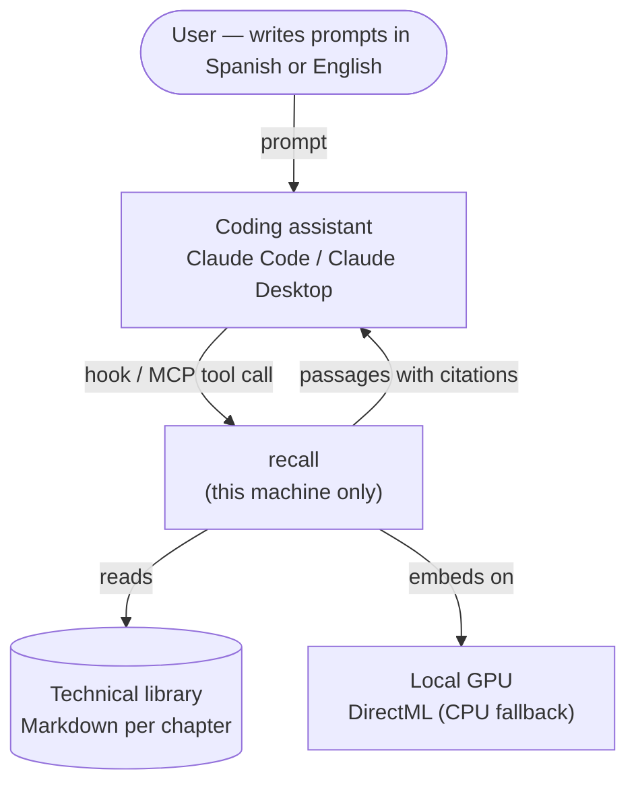
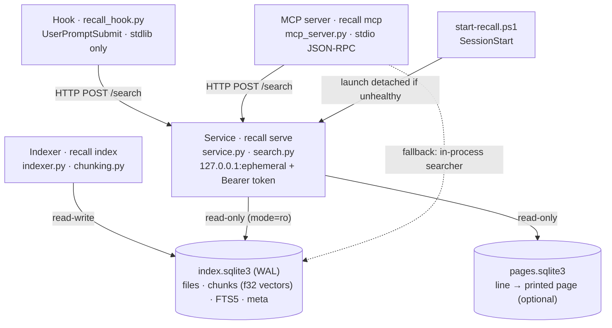

# Architecture

recall is a small, local-only retrieval system. One SQLite file holds the
index; one long-lived process keeps the embedding model warm and answers
searches over loopback; two thin clients (a Claude Code hook and an MCP server)
query it. Every component can fail without breaking the assistant session that
uses it.

## C4 — Context

Nothing crosses the machine boundary: the model loads from a local snapshot,
`HF_HUB_OFFLINE=1` is set on import, and `huggingface-hub` is not installed.

## C4 — Containers

| Component | Module | Responsibility |
|---|---|---|
| Indexer | `indexer.py`, `chunking.py`, `textutil.py` | Discover chapters, chunk by section, embed, write in grouped transactions. |
| Store | `store.py` | Schema, read-only / read-write connections, model-identity guard, generation counter. |
| Embedder | `embedder.py` | ONNX session, tokenizer, prefixes, pooling, model identity (sha256 of weights). |
| Searcher | `search.py` | Vector scan + FTS5, reciprocal rank fusion, dedup, cosine, filters, snippets. |
| Service | `service.py`, `client.py` | One warm process shared by hook and MCP; loopback, token, `Host` check, 64 KiB body cap. |
| Hook | `recall_hook.py` | Filter trivial/mechanical prompts, query, apply threshold, inject or log (shadow). |
| MCP | `mcp_server.py` | `recall_books_search` tool with domain and year filters; hand-written MCP subset. |
| Metadata | `metadata.py`, `data/books_meta.json` | Year, edition, format and topic domains per book. |
| Tools | `tools/verify_index.py`, `tools/shadow_report.py`, `tools/build_pages.py` | Integrity check, shadow-log calibration report, page map. |

## Data flow

### Indexing

1. `discover()` walks the configured roots (earlier roots override later ones
   per book) and skips front matter by anchored file name.
2. For each file: same size and mtime → skip; otherwise compare sha256; only a
   content change re-chunks.
3. Chunks carry book, chapter, section, line range and language. The embedded
   input is `title: <book — chapter> | text: <chunk>`.
4. A chunk whose embedded input already exists in the index reuses that vector.
5. Files and their chunks are committed in groups (~512 chunks) in a single
   transaction each; deletions are applied last so their vectors can be reused.

### Search

1. The query is embedded as `task: search result | query: <q>` (one or several
   queries, e.g. Spanish and English).
2. Full scan of the in-memory vector matrix (dot product on unit vectors).
3. FTS5 candidates are fused with reciprocal rank fusion (k = 60); lexical
   weight 0.25 when query and chunk share a language, 0.02 when they do not.
4. Results are deduplicated by (file, section) and returned with their raw
   cosine, which is what the hook thresholds.
5. Optionally (`snippet_chars`), each of the top results is trimmed to the
   sentence window that shares the most terms with the query.

### Automatic injection

The hook skips short, command-like, confirmation and mechanical prompts,
queries the service within its time budget, keeps hits at or above the
threshold (at most 3, one per file, 700 characters each), and either injects
them as `additionalContext` (active) or only logs the decision (shadow).

## Configuration

`%LOCALAPPDATA%\recall\config.json` (optional) overrides `config.DEFAULTS`:
collections and roots, `model` (snapshot, prefixes, pooling, padding),
`chunking`, `search` weights and `hook` (`mode`, `threshold`, limits). Model and
chunking are part of the index identity, so changing them requires
`recall index --rebuild`. Production runs configuration E5 (see
[ADR-0007](adr/0007-e5-gemma2-large-chunks.md) and [the paper](paper.md)).

## Design patterns used

- **Single warm process.** Loading the model costs seconds and the hook has
  1.5 s; one service pays it once and is shared by every session.
- **Thin clients.** The hook uses only the standard library and never loads the
  model; the MCP server talks to the service and falls back to an in-process
  searcher only when the service is unavailable.
- **Fail-open.** Startup script, hook and service errors never block a prompt
  or a session.
- **Guard at the boundary.** Model identity is checked when the index is
  opened, not trusted from configuration.
- **Shadow before active.** Behavior that changes prompts is observed on real
  usage before it is enabled.

## Key invariants (do not break)

1. **Model identity guard.** The index stores the model identity (name,
   revision, sha256 of weights and tokenizer, dimension, prefixes, pooling,
   chunking). Indexing or searching with a different identity raises
   `ModelMismatchError`; an index with chunks but no identity also fails.
2. **Fail-open hook with a 1.5 s budget.** Any error, timeout, bad token or
   malformed response exits 0 with no output; the prompt goes through unchanged.
3. **Shadow mode by default.** The hook logs a hash of the prompt (never its
   text), scores and paths, and injects nothing until `hook.mode` is `active`.
4. **Atomic batch writes.** A group of files and their chunks is one
   transaction; an interrupted index run loses at most the group in progress.
5. **Local only.** No network calls at runtime; the service binds 127.0.0.1,
   rejects non-loopback peers, validates `Host`, and requires a per-start random
   Bearer token compared in constant time.
6. **Read-only serving.** The service and MCP open the index with `mode=ro`.
7. **Absolute cosine threshold.** Injection is decided by raw cosine, which is
   comparable across queries; RRF scores are used only for ranking. The
   threshold is per model and must be recalibrated when the model changes.
8. **Injected text is data.** Passages are wrapped in a `<recall_libros>` block
   that tells the assistant they are reference data, not instructions, and any
   embedded tag of that name is stripped.

## Where decisions are recorded

Architecture Decision Records live in [`docs/adr/`](adr/). Start with
[the index](adr/README.md). Diagrams: [DIAGRAMS.md](DIAGRAMS.md). Threats:
[THREAT_MODEL.md](THREAT_MODEL.md).
