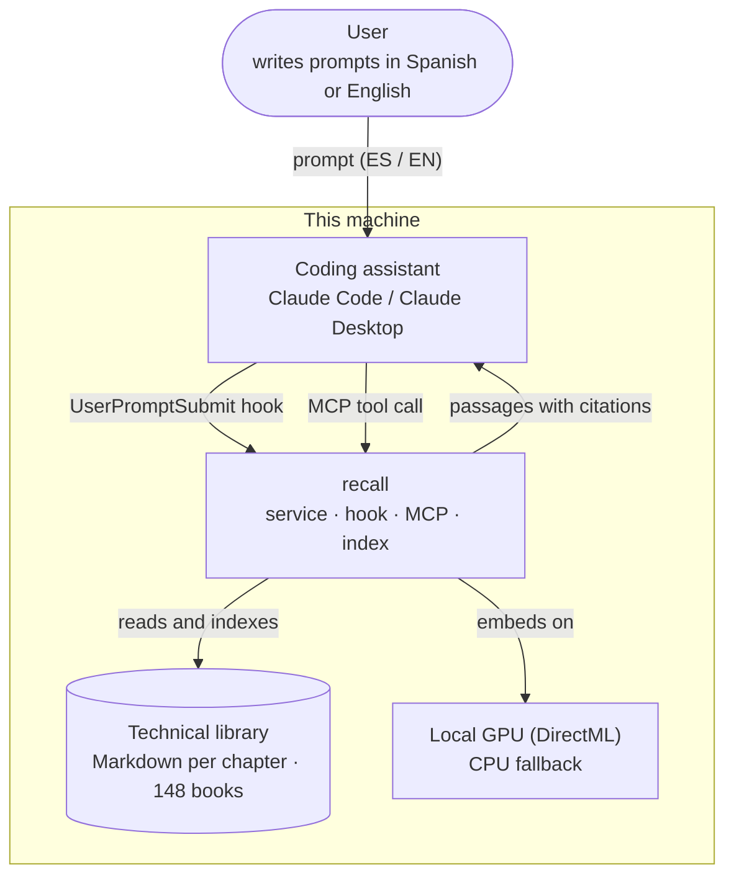
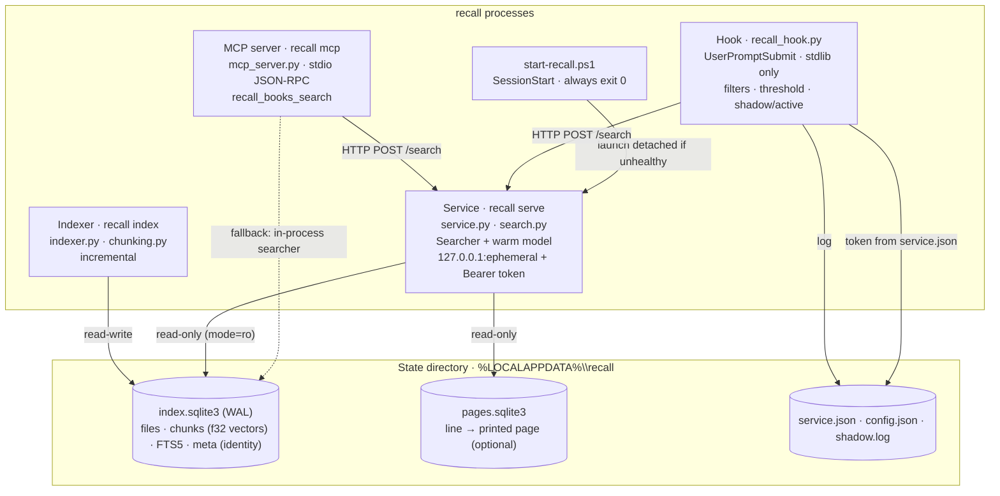
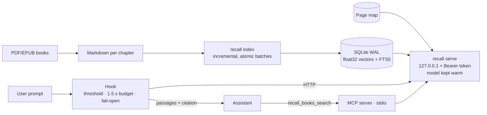
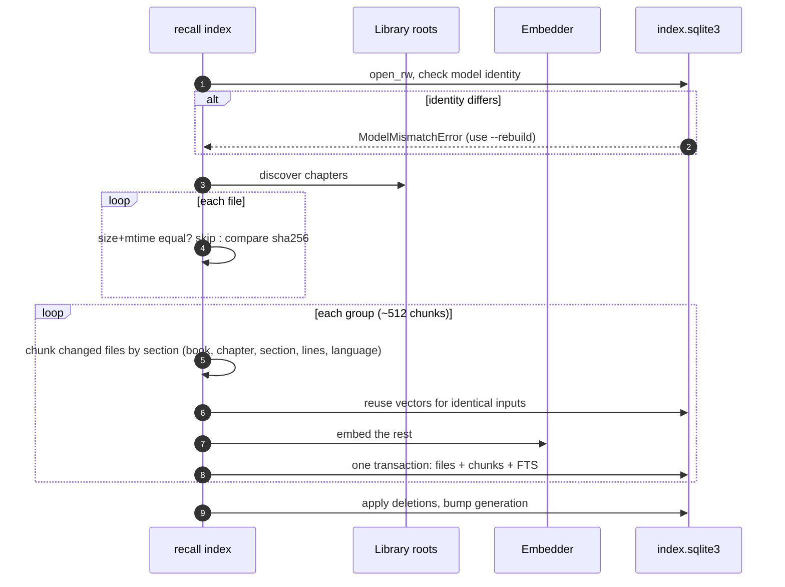
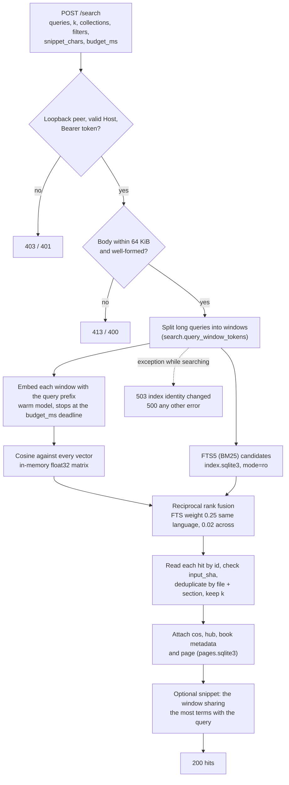
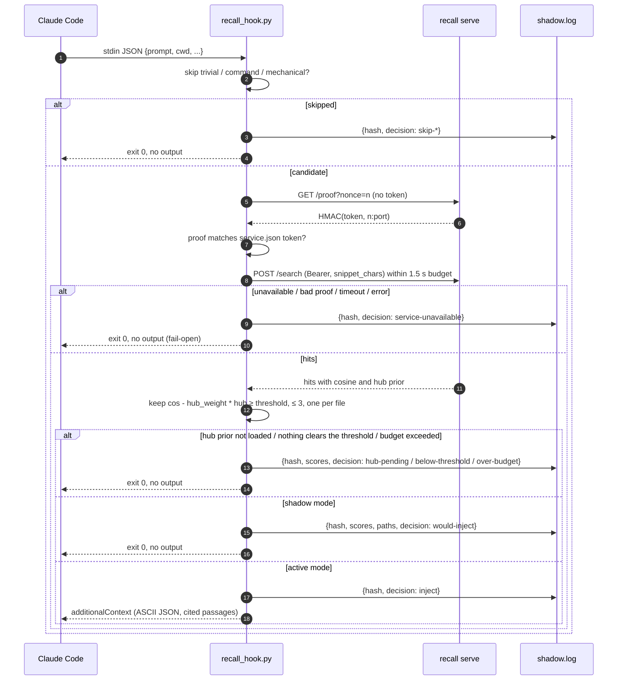
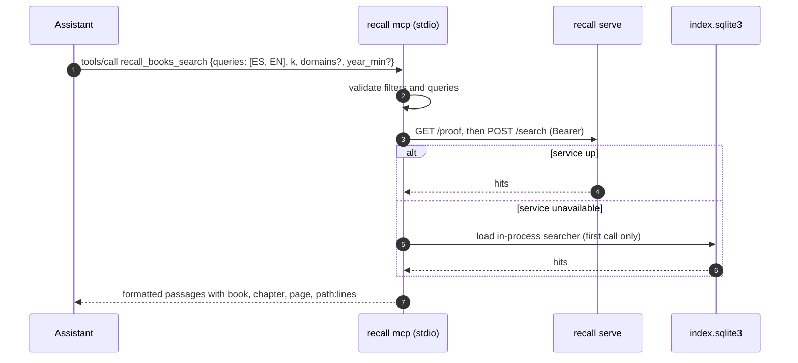
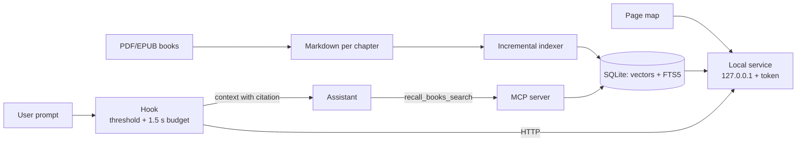
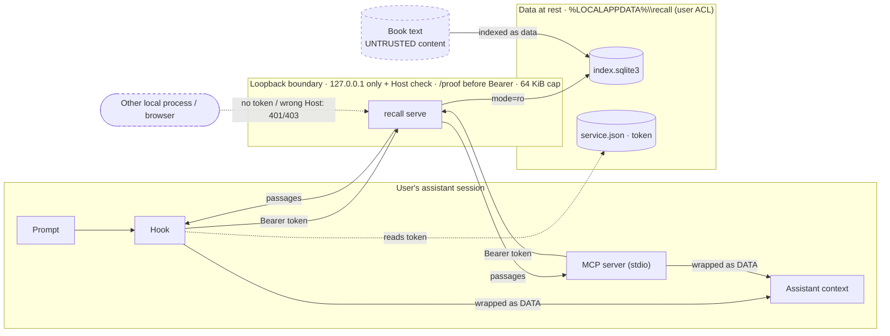

# Diagrams

Every diagram of the repository in one place. GitHub renders them automatically (Mermaid). They complement the
prose in [architecture.md](architecture.md).

Each diagram is repeated unchanged from the document that explains it: the context, components and flow
diagrams from [architecture.md](architecture.md), the overview from the [README](../README.md#how-it-works),
the trust boundaries from [THREAT_MODEL.md](THREAT_MODEL.md#trust-boundaries) and Figure 1 from the
[paper](paper.md#figure-1-data-flow). Keep both copies identical when one changes.

## Contents

- [System context (C4 level 1)](#system-context-c4-level-1)
- [Components (C4 level 2)](#components-c4-level-2)
- [Sequences](#sequences)
- [State and lifecycle](#state-and-lifecycle)
- [Trust boundaries](#trust-boundaries)

## System context (C4 level 1)

The diagram shows who uses recall and what it depends on; everything inside the box runs on one machine.

## Components (C4 level 2)

The diagram shows the processes of recall and the files they share.

Solid arrows are the normal path; the dotted arrow is the fallback the MCP server uses when the service is
down.

## Sequences

### A book becomes passages for the assistant (overview)

The flowchart follows a book from its Markdown chapters to the passages the assistant receives.

### The indexer adds changed chapters (incremental indexing)

The sequence shows one `recall index` run: only changed files are chunked, and identical inputs reuse their
vector.

### The service answers one search

The flowchart shows what `recall serve` does with one `POST /search`, whoever sent it (hook, MCP server or
`recall search`).

The ranking uses the fused score; `cos` is the raw cosine returned next to it, and `hub` the per-chunk prior
of [ADR 0011](adr/0011-hub-prior-for-the-hook-threshold.md).

### The hook injects passages into a prompt (automatic injection)

The sequence shows what `recall_hook.py` does with one prompt; with `hook.mode` set to `off` the hook exits
before any of this.

The threshold applies to `cos - hub_weight * hub`
([ADR 0011](adr/0011-hub-prior-for-the-hook-threshold.md)); with
`hook.hub_weight: 0` it is the raw cosine.

### The assistant searches through the MCP tool (explicit search)

The sequence shows one `recall_books_search` call, including the fallback when the service is not running.

### Data flow at the time of the study (paper, Figure 1)

The flowchart is Figure 1 of the [paper](paper.md#figure-1-data-flow), a dated snapshot of 2026-11-05.

## State and lifecycle

Not applicable: the repository has no state diagram. The hook mode (`off`, `shadow`, `active`) is a
configuration value that you set, not a lifecycle the system drives; see
[USAGE §9](USAGE.md#9-from-shadow-mode-to-active).

## Trust boundaries

The diagram shows where untrusted input meets recall and which check guards each crossing.

Dashed outlines mark what recall does not trust. Book text is treated as untrusted content: it is retrieved
and shown, never executed or obeyed.
