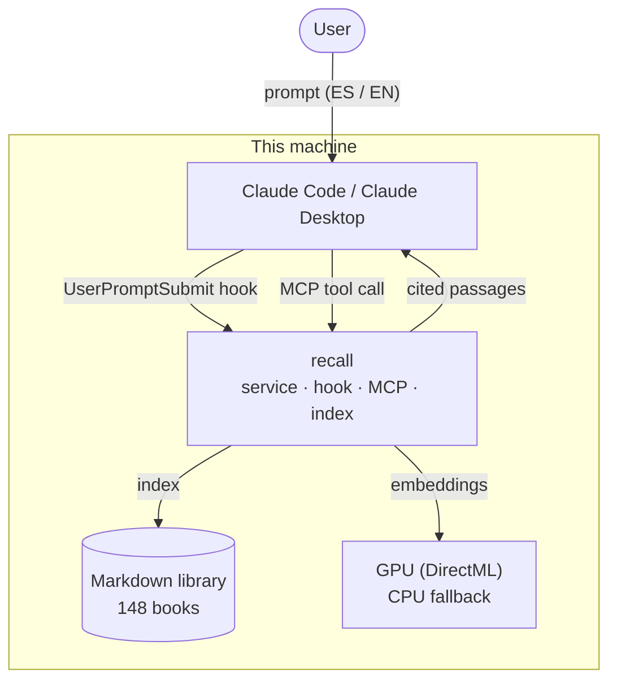
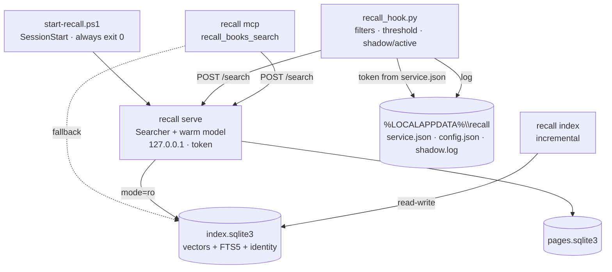
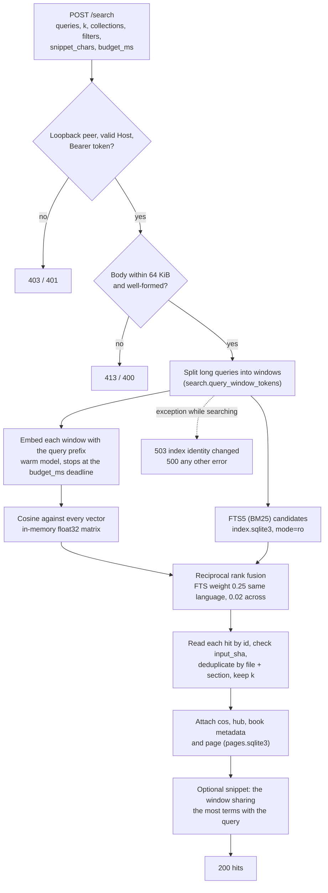
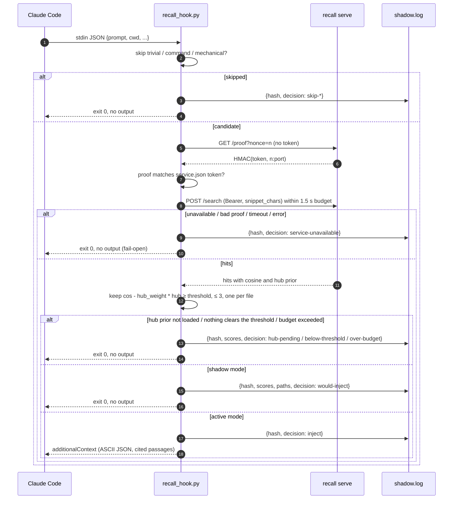
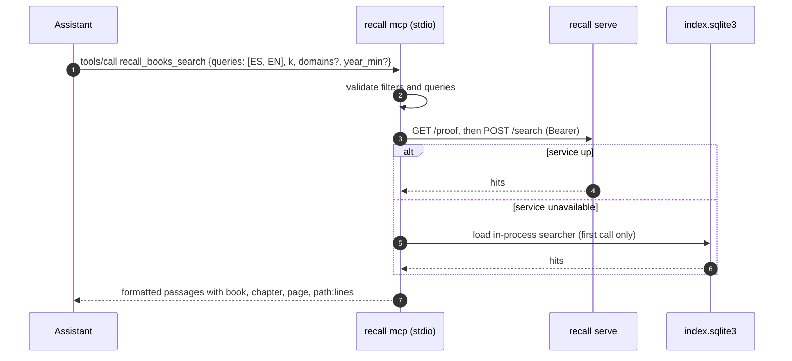
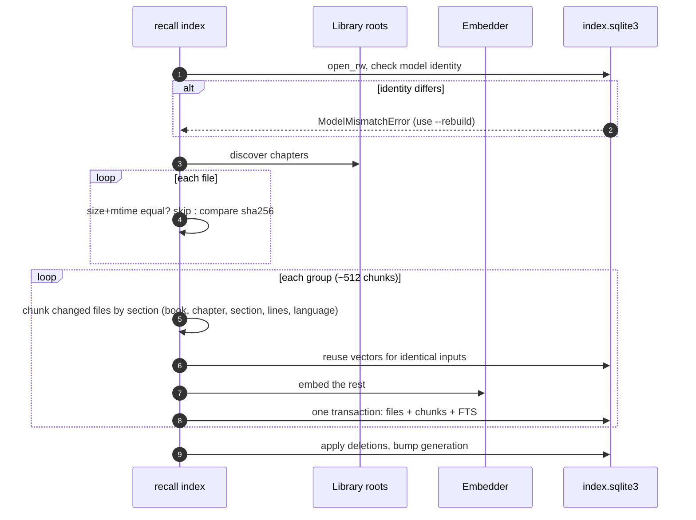
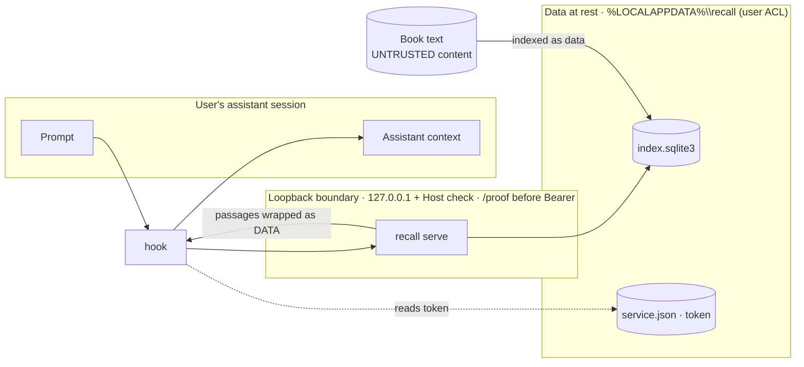

# Diagrams

Rendered by GitHub automatically (Mermaid). They complement the prose in
[architecture.md](architecture.md).

The indexing, search, hook and MCP diagrams are repeated in the
[README](../README.md#how-it-works); keep both copies identical when one
changes.

## System context (C4 level 1)

## Components (C4 level 2)

## Search inside the service

What `recall serve` does with one `POST /search`, whoever sent it (hook, MCP
server or `recall search`). The ranking uses the fused score; `cos` is the raw
cosine returned next to it, and `hub` the per-chunk prior of
[ADR 0011](adr/0011-hub-prior-for-the-hook-threshold.md).

## Sequence — automatic injection (hook)

With `hook.mode` set to `off` the hook exits before any of this. The
threshold applies to `cos - hub_weight * hub`
([ADR 0011](adr/0011-hub-prior-for-the-hook-threshold.md)); with
`hook.hub_weight: 0` it is the raw cosine.

## Sequence — explicit search (MCP)

## Sequence — incremental indexing

## Trust boundaries

