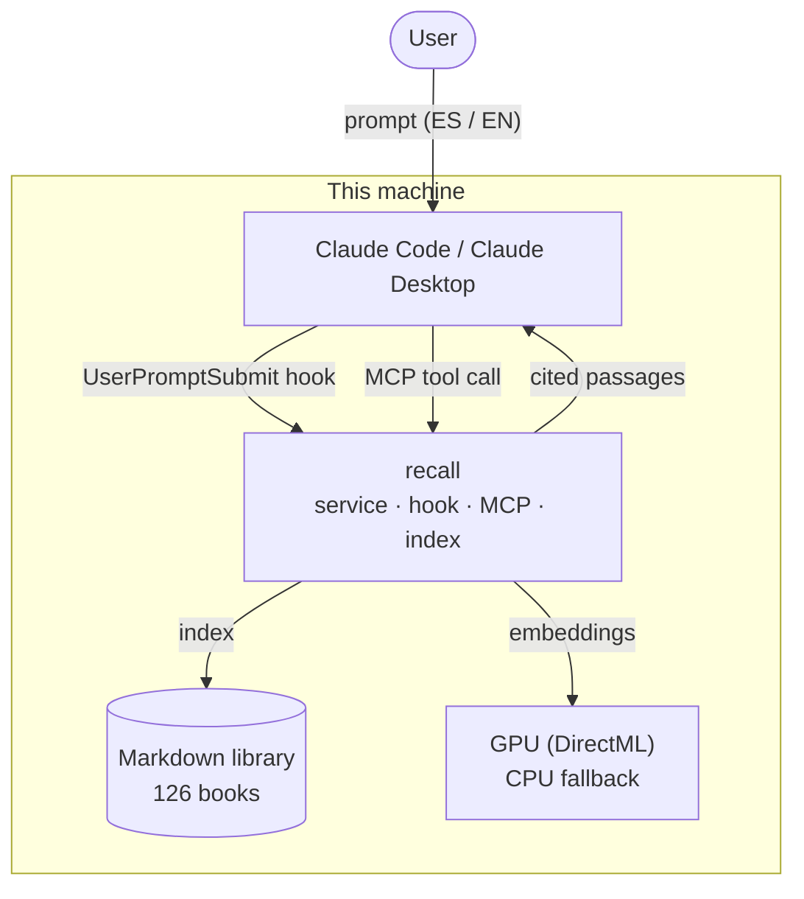
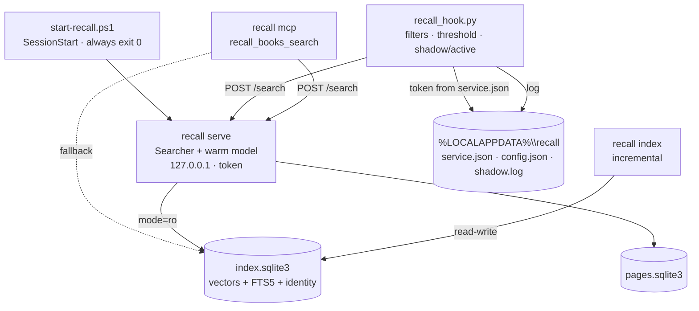
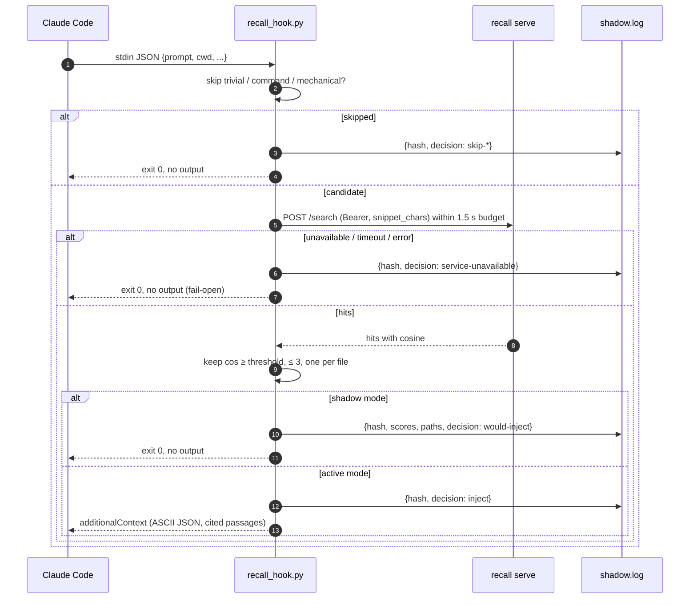
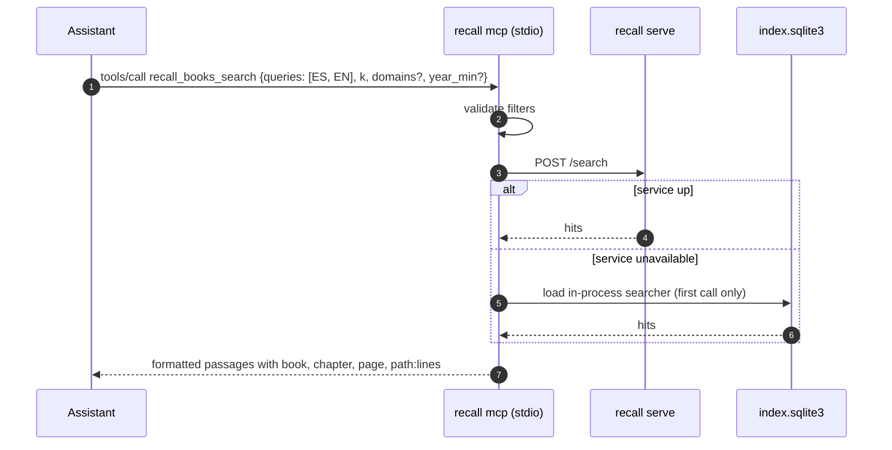
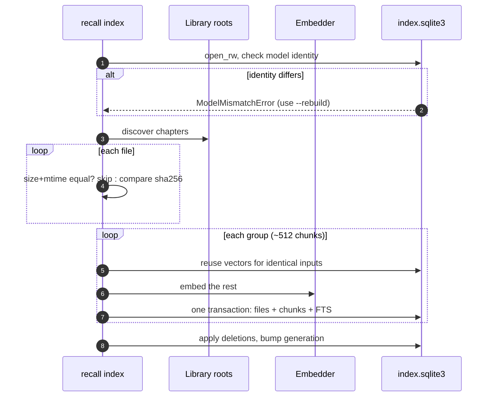
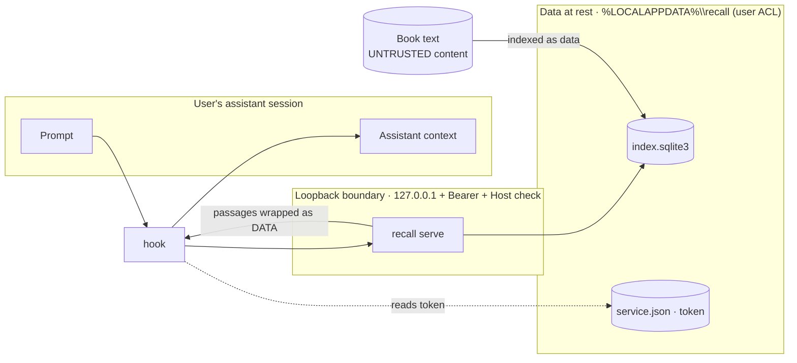

# Diagrams

Rendered by GitHub automatically (Mermaid). They complement the prose in
[ARCHITECTURE.md](ARCHITECTURE.md).

## System context (C4 level 1)

## Components (C4 level 2)

## Sequence — automatic injection (hook)

## Sequence — explicit search (MCP)

## Sequence — incremental indexing

## Trust boundaries

