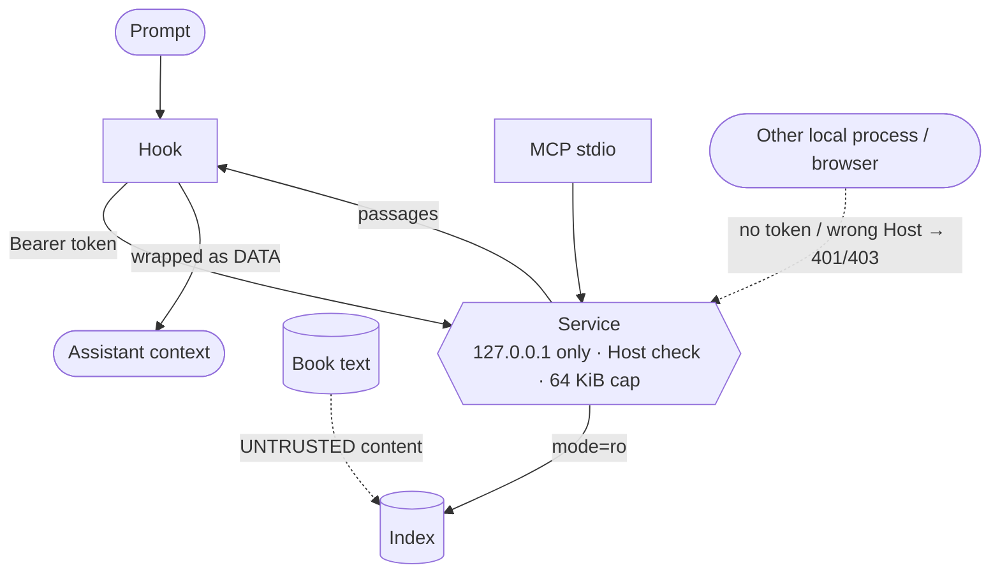

# Threat Model

A STRIDE-oriented look at recall. The system indexes a local library of
technical books, serves searches over loopback, and inserts retrieved passages
into a coding assistant's context, either automatically (hook) or on request
(MCP tool).

## Assets

| Asset | Why it matters |
|---|---|
| The user's prompts | May contain private work context; recall must send them nowhere but its own service, and never log them in clear. |
| The assistant's context | Injected text influences what the assistant does. |
| The index (`index.sqlite3`) | Tampering changes what is retrieved and injected. |
| The service token (`service.json`) | Grants access to the search endpoint. |
| The host machine | Runs the service, the model and the hook on every prompt. |

## Trust boundaries

Book text is treated as untrusted content: it is retrieved and shown, never
executed or obeyed.

## STRIDE

### Spoofing
- *Another local process or a web page calls the service.* Mitigation: the
  service binds 127.0.0.1 on an ephemeral port, rejects non-loopback peers,
  validates the `Host` header (127.0.0.1/localhost with its own port) against
  DNS rebinding, and requires a Bearer token compared with
  `hmac.compare_digest`.
- *A stale or foreign process impersonates the service.* When the service dies
  without cleaning up (killed with `taskkill /F`, a crash, a power loss),
  `service.json` still names its port, and any local process can bind that
  port. Mitigation: a server-proof handshake. The token is random per start
  (`secrets.token_urlsafe(32)`) and lives in `service.json`, written
  atomically and restricted to the current user's ACL, so an impostor cannot
  read it. Before sending the token or any prompt text, every client (hook,
  `recall.client`, `start-recall.ps1`) sends an unauthenticated
  `GET /proof?nonce=<n>` with a fresh random nonce (16–128 characters of
  `[A-Za-z0-9_-]`); the server answers
  `{"proof": HMAC-SHA256(token, "recall-proof:<n>:<port>")}` and the client
  compares it, in constant time, with its own computation. Binding the port
  into the MAC defeats an impostor that relays the genuine server's answer
  from another port. A server that fails the proof gets nothing secret, and
  the launcher never kills an unproven pid: on a 503 it stops only the pid
  that the *proven* server reports. `service.json` is validated by every
  reader (integer port 1–65535, integer pid > 0, printable ASCII token without
  spaces, at most 512 characters); anything else is "no service". Residuals:
  a gap of a few milliseconds between the proof and the request (HTTP/1.0, one
  connection per request), in which the real service would have to die and an
  impostor bind the same port; `/proof` itself is unauthenticated, but
  loopback-only and `Host`-validated, and reveals only an HMAC of a
  client-chosen nonce. Upgrade note: a still-running service from before
  0.3.0 has no `/proof`, so clients fail open and the launcher starts a new
  one; stop the old service once after upgrading.

### Tampering
- *Index modified to inject chosen text.* Mitigation: the index lives under
  the user's `%LOCALAPPDATA%\recall`; the service opens it read-only; the
  injected block is labeled as data. Residual: anyone who can write the user's
  profile can change what is retrieved — out of scope (same privilege as the
  user).
- *Index silently built with a different model.* Mitigation: the model
  identity (sha256 of weights and tokenizer, revision, prefixes, chunking,
  `doc_max_tokens`) is stored and checked; mismatches raise
  `ModelMismatchError`. If the index is rebuilt with another identity while
  the service runs, the background reload records it (`load_error`): searches
  answer 503 and `/health` reports not-ok, so the launcher restarts the
  service instead of it serving old vectors joined to new rows.
- *Stale snapshot paired with rewritten rows.* Row ids are reused after a
  rebuild. Mitigation: each hit row is verified against the snapshot's
  `input_sha`; a mismatch is never returned and triggers a reload.
- *Content from outside the library (containment).* A directory junction
  (`mklink /J`, no admin rights needed) or a symlink inside a root could make
  arbitrary files indexable and then injectable. Mitigation: links and
  junctions are ignored, and anything whose real path is not under the root's
  real path is skipped.
- *Hostile `books_meta.json`.* Mitigation: entries are normalized on load
  (non-object entries dropped, `domains` a list of strings, `year` an int in
  range or null, text fields strings), so a malformed file cannot break every
  search; a missing or invalid file is reported (`meta_error`).
- *Index integrity drift.* Mitigation: `tools/verify_index.py` checks SQLite
  integrity, chunk accounting, vector validity, text-to-vector correspondence,
  FTS rows, coverage, and re-embeds a sample.

### Repudiation
- Not a goal for a single-user local tool. The shadow log records decisions
  (hash, scores, paths, latency) for calibration, not for audit.

### Information disclosure
- *Prompts logged in clear.* Mitigation: `shadow.log` stores a hash of the
  prompt, never its text; the service writes no access log.
- *Data leaving the machine.* Mitigation: no runtime network calls;
  `HF_HUB_OFFLINE=1` is set on import; `huggingface-hub` is excluded from the
  lock file so there is no code path to the Hub; the model loads from a local
  snapshot.
- *Unrelated private data reaching the context.* Mitigation: the hook and MCP
  query only the `books` collection, which contains only book text.
- *Retrieved text and paths reaching the assistant's provider.* By design,
  passages are sent to the assistant as part of the prompt. The hook cites
  library-relative paths; the MCP tool returns absolute local paths (which
  include the user name) so the assistant can open the file. Residual,
  documented in the README and USAGE: index only what you are willing to share
  with that provider.
- *Prompt sent to an impostor.* See Spoofing: no prompt text leaves a client
  before the server proof succeeds.
- *Publication hygiene.* The repository carries no book content and no source
  file names: `data/books_meta.json` holds only bibliographic metadata, the
  local map of book ids to PDF paths (`data/books_sources.local.json`) is
  git-ignored, and `tests/test_publication.py` fails if a tracked text file
  contains any of a list of private terms (kept as digests, not in clear).

### Denial of service
- *Slow or crashed service blocks prompts.* Mitigation: the hook has a 1.5 s
  total budget and fails open; the startup script always exits 0; the MCP
  server falls back to an in-process searcher.
- *Oversized requests.* Mitigation: 64 KiB body cap and bounded `k`.
- *Slow-loris / slot exhaustion.* At most 32 concurrent connections; each
  connection must deliver its whole request within an absolute 3 s deadline
  (a timer that cuts the socket), so trickling one byte at a time cannot hold
  a slot.
- *Requests that fail deterministically.* A query with a lone surrogate (valid
  JSON, not encodable as UTF-8) or a deeply nested JSON body gets 400 from the
  service and `isError` / -32700 from the MCP server (which keeps serving),
  and never counts as an engine failure.
- *Repeated errors exhausting the engine guard.* Rule: an ONNX Runtime error
  rebuilds the session at once; any other error only on the second in a row
  and at most once per run of failures, and it never counts toward giving up.
  Only engine errors that persist across `max_rebuilds` rebuilds (or a failed
  rebuild) make the service give up. Replaced sessions are released.
- *Pathological headings.* The heading parser is linear; the previous regex
  backtracked quadratically on long runs of spaces (ReDoS: a heading with
  4,000 spaces stalled indexing for minutes).

### Elevation of privilege
- *Prompt injection from book content.* A passage could contain text that reads
  like instructions. Mitigation: passages are wrapped in a `<recall_books>`
  block (hook) or `<<<data>>>` / `<<<passage n>>>` delimiters (MCP) that state
  they are reference data and must not be obeyed. In every untrusted field —
  text, book, chapter, section, year, edition, page, path, lines — `<`, `>`
  and their look-alikes (fullwidth, small, angle quotation marks, CJK and
  math angle brackets) become the entities `&lt;` / `&gt;` (replaced, not
  stripped, so `List<T>` stays readable), and header fields are collapsed to
  one line, so content can neither close the block early nor forge an extra
  `[n] ...` entry or `source:` line. Passages are capped (3 × 700 characters
  in the hook); injection only happens above the cosine threshold and only in
  active mode. Residual: the assistant may still be influenced by data; the
  library is the user's own collection, which limits who can plant content.
- *Code execution through the service.* Mitigation: the service only returns
  text; it executes nothing from the index or the request.

## Supply chain

- `requirements.lock` pins every dependency with hashes (`uv pip compile
  --generate-hashes`), installed offline from a local cache; the build backend
  (`hatchling`, `editables`) is in it too, so the editable install runs
  without build isolation. Dev and CI tools are hash-locked in
  `requirements-dev.lock`.
- CI: least-privilege `permissions`, actions pinned by commit SHA, checkouts
  without persisted credentials, CodeQL (Python and Actions) and an advisory
  `pip-audit` of both locks.
- Few runtime dependencies: `numpy`, `onnxruntime-directml`, `tokenizers`.
  The hook is standard-library only.
- `huggingface-hub` is deliberately excluded (`requirements.excludes`).
- The MCP subset (initialize, tools/list, tools/call, ping) is implemented by
  hand instead of pulling the SDK and its transitive dependencies.
- Model weights are identified by sha256 in the index identity.

## Out of scope

- An attacker with write access to the user's profile or to the library.
- Multi-user machines where another user shares the same account.
- Correctness of the assistant's use of retrieved passages.
