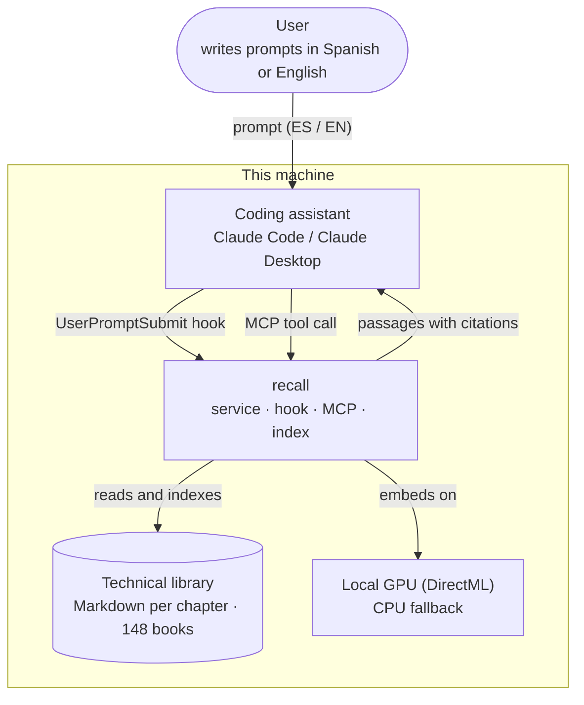
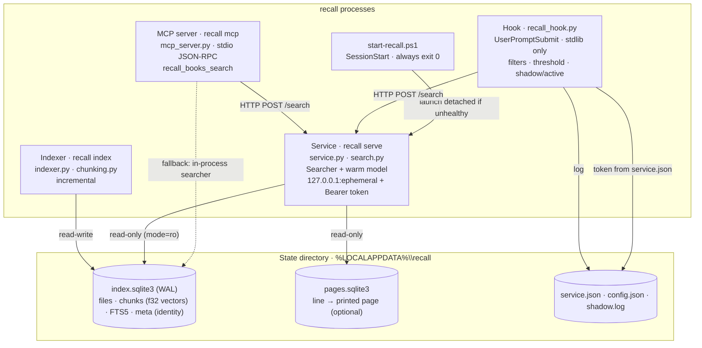
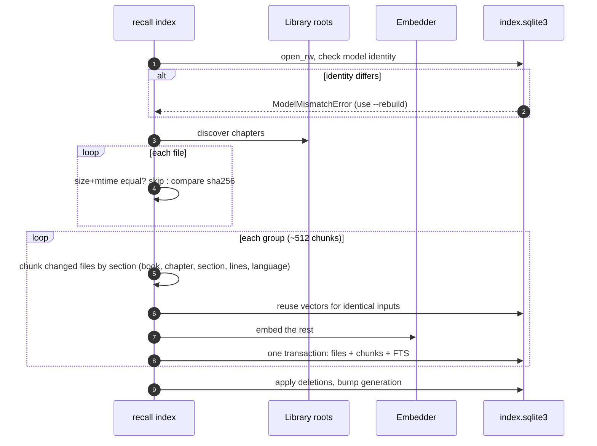
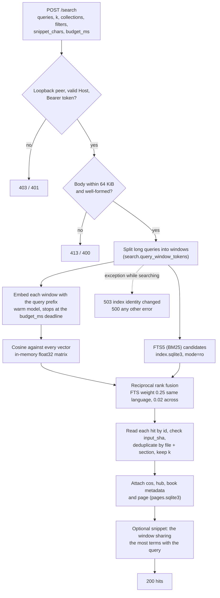
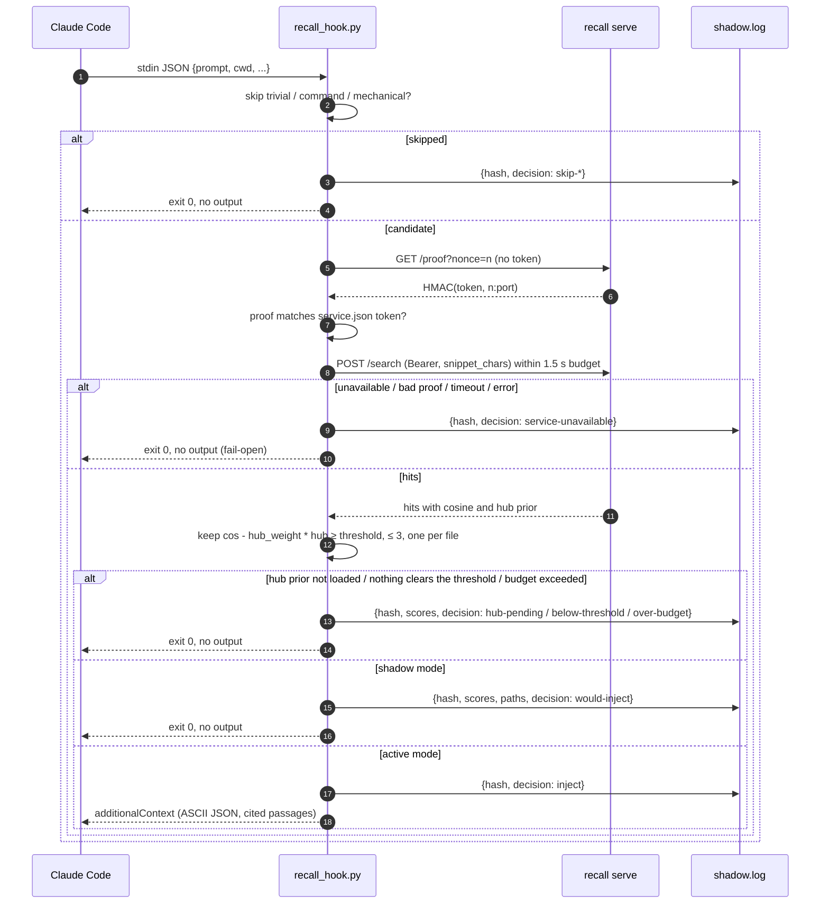
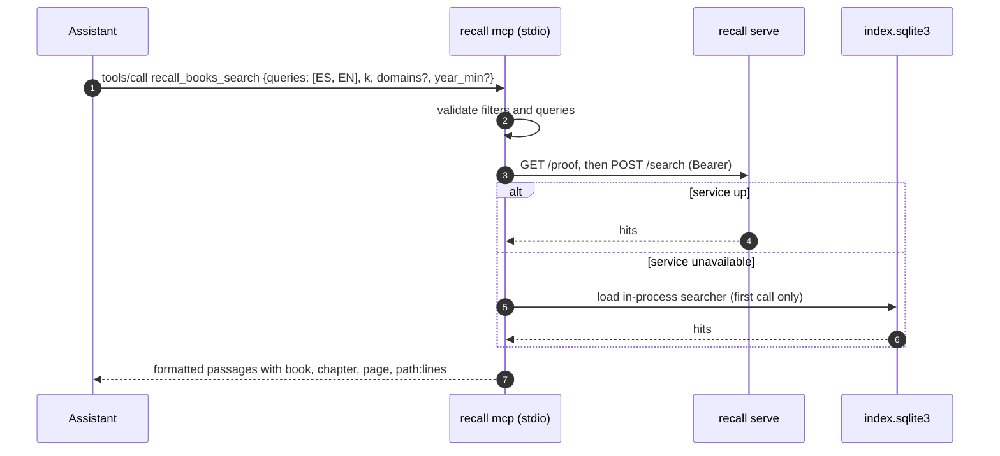

# Architecture

recall is a small, local-only retrieval system. One SQLite file holds the
index; one long-lived process keeps the embedding model warm and answers
searches over loopback; two thin clients (a Claude Code hook and an MCP server)
query it. Every component can fail without breaking the assistant session that
uses it.

## Contents

- [Context](#context)
- [Components](#components)
- [Service protocol](#service-protocol)
- [Configuration](#configuration)
- [Flows](#flows)
- [State](#state)
- [Design patterns](#design-patterns)
- [Invariants](#invariants)
- [Decisions](#decisions)

## Context

The diagram shows who uses recall and what it depends on; everything inside the box runs on one machine.

Retrieval never crosses the machine boundary: the model loads from a local
snapshot, `HF_HUB_OFFLINE=1` is set on import, `huggingface-hub` is not
installed, and the service listens on loopback only. What recall *returns*
does cross it: the passages and citations it hands to the assistant (and, from
the MCP tool, absolute file paths) become part of the prompt sent to the
assistant's provider.

## Components

The diagram shows the processes of recall and the files they share.

Solid arrows are the normal path; the dotted arrow is the fallback the MCP server uses when the service is
down.

| Component | Module | Responsibility |
|---|---|---|
| Indexer | `indexer.py`, `chunking.py`, `textutil.py` | Discover chapters, chunk by section, embed, write in grouped transactions. |
| Store | `store.py` | Schema, read-only / read-write connections, model-identity guard, generation counter. |
| Embedder | `embedder.py` | ONNX session, tokenizer, prefixes, pooling, model identity (sha256 of weights). |
| Searcher | `search.py` | Vector scan + FTS5, reciprocal rank fusion, dedup, cosine, filters, snippets. |
| Hub prior | `hub.py`, `hub_prompts.json` | Per-chunk closeness to generic coding prompts, returned as `hub` and subtracted by the hook before its threshold (ADR 0011). |
| Service | `service.py`, `client.py` | One warm process shared by hook and MCP; loopback, token, `Host` check, `/proof` handshake, 64 KiB body cap, 32 connections, 3 s request-read deadline, engine guard. |
| Hook | `recall_hook.py` | Filter trivial/mechanical prompts, query, apply threshold to `cos - hub`, inject or log (shadow). |
| MCP | `mcp_server.py` | `recall_books_search` tool with domain and year filters; hand-written MCP subset. |
| Metadata | `metadata.py`, `data/books_meta.json` | Year, edition, format and topic domains per book. |
| Tools | `tools/verify_index.py`, `tools/shadow_report.py`, `tools/build_pages.py` | Integrity check, shadow-log calibration report, page map. |

## Service protocol

`service.json` (user-only ACL) holds `port`, `token` and `pid`; every reader
(service, client, hook, launcher) validates it the same way — integer port
1–65535, integer pid > 0, printable ASCII token without spaces, at most 512
characters — and treats anything else as "no service". Before sending the
token or a prompt, a client calls `GET /proof?nonce=<n>` (no token; `<n>` is
16–128 characters of `[A-Za-z0-9_-]`) and checks the answer,
`HMAC-SHA256(token, "recall-proof:<n>:<port>")`. `GET /health` (token) reports
`ok`, counts, `providers`, `device_id`, `meta_error` and `load_error`, and
answers 503 when the engine guard gave up or the index identity changed;
`POST /search` (token) answers 503 `index identity changed` in the latter
case. `start-recall.ps1` launches
`.venv\Scripts\pythonw.exe -I -c "...main(['serve'])" <statedir>` detached,
honoring `RECALL_HOME`.

## Configuration

`%LOCALAPPDATA%\recall\config.json` (optional) overrides `config.DEFAULTS`:
collections and roots, `model` (snapshot, prefixes, pooling, padding),
`chunking`, `search` weights and `hook` (`mode`, `threshold`, limits). Model and
chunking are part of the index identity, so changing them requires
`recall index --rebuild`. Production runs configuration E5 (see
[ADR-0007](adr/0007-e5-gemma2-large-chunks.md) and [the paper](paper.md)). The key-by-key reference is in
[USAGE §10](USAGE.md#10-configuration).

## Flows

### Indexing

Markdown chapters become chunks, chunks become vectors, and both land in one
SQLite file together with the FTS5 rows (`src/recall/indexer.py`,
`chunking.py`, `store.py`).

The sequence shows one `recall index` run: only changed files are chunked, and identical inputs reuse their
vector.

1. `discover()` walks the configured roots (earlier roots override later ones
   per book), skips front matter by anchored file name, and ignores links,
   junctions and anything whose real path is outside the root. A configured
   root that does not exist keeps its indexed files and is reported as an
   error.
2. For each file: same size and mtime → skip; otherwise compare sha256; only a
   content change re-chunks.
3. Chunks carry book, chapter, section, line range and language. The embedded
   input is `title: <book — chapter> | text: <chunk>`.
4. A chunk whose embedded input already exists in the index reuses that vector.
5. Files and their chunks are committed in groups (~512 chunks) in a single
   transaction each; deletions are applied last so their vectors can be reused.

### Search

Every search — from the hook, the MCP server or `recall search` — is one
`POST /search` to `recall serve` (`src/recall/service.py`, `search.py`).

The flowchart shows what `recall serve` does with one `POST /search`, whoever sent it (hook, MCP server or
`recall search`).

The ranking uses the fused score; `cos` is the raw cosine returned next to it, and `hub` the per-chunk prior
of [ADR 0011](adr/0011-hub-prior-for-the-hook-threshold.md).

1. The query is embedded as `task: search result | query: <q>` (one or several
   queries, e.g. Spanish and English).
2. Full scan of the in-memory vector matrix (dot product on unit vectors).
3. FTS5 candidates are fused with reciprocal rank fusion (k = 60); lexical
   weight 0.25 when query and chunk share a language, 0.02 when they do not.
4. Results are deduplicated by (file, section) and returned with their raw
   cosine, which is what the hook thresholds.
5. Optionally (`snippet_chars`), each of the top results is trimmed to the
   sentence window that shares the most terms with the query.

### Automatic injection

`recall_hook.py` either adds passages or leaves the prompt alone; every other
outcome is exit 0 with no output. The threshold applies to the cosine minus
the hub prior ([ADR 0011](adr/0011-hub-prior-for-the-hook-threshold.md)).

The sequence shows what `recall_hook.py` does with one prompt; with `hook.mode` set to `off` the hook exits
before any of this.

The threshold applies to `cos - hub_weight * hub`
([ADR 0011](adr/0011-hub-prior-for-the-hook-threshold.md)); with
`hook.hub_weight: 0` it is the raw cosine.

The hook skips short, command-like, confirmation and mechanical prompts,
queries the service within its time budget, keeps hits whose
`cos - hub_weight * hub` is at or above the threshold (at most 3, one per
file, 700 characters each), and either injects
them as `additionalContext` (active) or only logs the decision (shadow).

### Explicit search (MCP)

`recall mcp` (`src/recall/mcp_server.py`) asks the same service and falls back
to an in-process searcher when it is not running.

The sequence shows one `recall_books_search` call, including the fallback when the service is not running.

## State

All run-time state lives in `%LOCALAPPDATA%\recall` (or `RECALL_HOME`), never in the repository.

| What | Where | Format | Lifetime |
|---|---|---|---|
| The index: files, chunks, vectors, FTS5, model identity | `index.sqlite3` (+ `-wal`, `-shm`) | SQLite in WAL mode; vectors as float32 blobs; tables `meta`, `files`, `chunks`, `fts` | Updated by each `recall index`; dropped and rebuilt by `--rebuild`. |
| Overrides of the code defaults | `config.json` | JSON, merged section by section | Optional; written by you; read on every start and by every hook call. |
| Port, token and pid of the running service | `service.json` | JSON, user-only ACL | Written by `recall serve` at start; the token is random per start. |
| Start-up lock of the service | `serve.lock` | Lock file | Held while a `recall serve` runs; the OS releases it if the process dies. |
| Why the service was or was not started | `start.log` | Text | Appended by `start-recall.ps1`; rotated at 1 MiB. |
| Search errors by exception type (never the query), engine rebuilds | `serve.log` | Text | Appended by `recall serve`; rotated at 1 MiB. |
| One line per prompt: hash, scores, decision (never the prompt text) | `shadow.log` (+ `.1`…) | JSON lines | Appended by `recall_hook.py`; rotated at 5 MiB, 3 copies kept. |
| Key of the prompt hash in `shadow.log` | `log.key` | 32 random bytes | Created by the hook on first use; per install. |
| sha256 of the model files, keyed by path, size and mtime | `model_digest.json` | JSON | Cache; the service deletes it at start so the files are hashed again. |
| Reference vectors of the hub prior (ADR 0011) | `hub_ref.npz` | NumPy archive | Cache written by `recall serve`; recomputed when it does not match. |
| Line → printed page map | `pages.sqlite3` | SQLite; tables `pages`, `books` | Optional; built by `tools/build_pages.py`; regenerate after re-converting books. |
| Experiment indexes | `%LOCALAPPDATA%\recall-exp\<name>` | Same layout as the state directory | Written by `experiments\run.ps1`; never touches production. |

Two data files live in the repository instead: `data/books_meta.json` (bibliographic metadata, also shipped
in the package) and the git-ignored `data/books_sources.local.json` (local map of book ids to PDF paths, used
only by `tools/build_pages.py`).

## Design patterns

- **Single warm process.** Loading the model costs seconds and the hook has
  1.5 s; one service pays it once and is shared by every session.
- **Thin clients.** The hook uses only the standard library and never loads the
  model; the MCP server talks to the service and falls back to an in-process
  searcher only when the service is unavailable.
- **Fail-open.** Startup script, hook and service errors never block a prompt
  or a session.
- **Guard at the boundary.** Model identity is checked when the index is
  opened, not trusted from configuration.
- **Shadow before active.** Behavior that changes prompts is observed on real
  usage before it is enabled.

## Invariants

Do not break these rules.

1. **Model identity guard.** The index stores the model identity (name,
   revision, sha256 of weights and tokenizer, dimension, prefixes, pooling,
   chunking, `doc_max_tokens` when not the default). Indexing or searching
   with a different identity raises `ModelMismatchError`; an index with chunks
   but no identity also fails. A background reload in the running service that
   finds another identity sets `Searcher.load_error`: searches raise
   `ModelMismatchError` (503) and `/health` reports not-ok until the service
   is restarted on the new index.
2. **Fail-open hook with a 1.5 s budget.** Any error, timeout, bad token or
   malformed response exits 0 with no output; the prompt goes through unchanged.
3. **Shadow mode by default.** The hook logs a hash of the prompt (never its
   text), scores and paths, and injects nothing until `hook.mode` is `active`.
4. **Atomic batch writes.** A group of files and their chunks is one
   transaction; an interrupted index run loses at most the group in progress.
5. **Local only.** No network calls at runtime; the service binds 127.0.0.1,
   rejects non-loopback peers, validates `Host`, and requires a per-start random
   Bearer token compared in constant time. No client sends the token or a
   prompt to a server that has not passed the `/proof` check.
6. **Read-only serving.** The service and MCP open the index with `mode=ro`.
7. **Absolute cosine threshold.** Injection is decided by raw cosine, which is
   comparable across queries; RRF scores are used only for ranking. Since
   [ADR-0011](adr/0011-hub-prior-for-the-hook-threshold.md) the hook subtracts
   the per-chunk hub prior from that cosine before comparing
   (`cos - hub_weight * hub`; `hook.hub_weight: 0` compares the raw cosine).
   The threshold is per model and must be recalibrated when the model changes.
8. **Injected text is data.** Passages are wrapped in a `<recall_books>` block
   (hook) or `<<<data>>>`/`<<<passage n>>>` delimiters (MCP) that tell the
   assistant they are reference data, not instructions. In every field taken
   from the index (text, book, chapter, section, year, edition, page, path,
   lines), `<`, `>` and their look-alikes (fullwidth, small, angle quotes, CJK
   and math angle brackets) are replaced with the entities `&lt;`/`&gt;` —
   not stripped — and header fields are collapsed to one line, so no field can
   close the block or forge an entry or a `source:` line.
9. **Snapshot/row consistency.** Vectors live in an in-memory snapshot while
   hit text is read from the live index by id, and ids are reused after a
   rebuild. Each fetched row is checked against the snapshot's `input_sha`; a
   mismatching row is never returned and triggers a reload.

## Decisions

Architecture Decision Records live in [`docs/adr/`](adr/). Start with
[the index](adr/README.md). Diagrams: [DIAGRAMS.md](DIAGRAMS.md). Operations:
[runbook.md](runbook.md). Threats:
[THREAT_MODEL.md](THREAT_MODEL.md).

| ADR | Decision |
|---|---|
| [0001](adr/0001-sqlite-brute-force-vectors.md) | SQLite with brute-force vectors and FTS5, no vector database |
| [0002](adr/0002-cosine-absolute-threshold.md) | Raw cosine with an absolute threshold for automatic injection |
| [0003](adr/0003-fail-open-hook-budget.md) | Fail-open hook with a 1.5 s time budget |
| [0004](adr/0004-shadow-mode-before-activation.md) | Shadow mode before activating injection |
| [0005](adr/0005-model-identity-guard.md) | Model identity guard in the index |
| [0006](adr/0006-local-onnx-directml-offline.md) | Local ONNX model on DirectML, fully offline |
| [0007](adr/0007-e5-gemma2-large-chunks.md) | Production configuration E5: embeddinggemma-2 with ~3,500-character chunks |
| [0008](adr/0008-query-windows-for-long-prompts.md) | Split long prompts into ≤32-token query windows |
| [0009](adr/0009-queries-on-cpu.md) | Embed queries on CPU, index on DirectML (superseded by 0010) |
| [0010](adr/0010-directml-one-query-shape.md) | Queries on DirectML at one fixed input shape |
| [0011](adr/0011-hub-prior-for-the-hook-threshold.md) | Subtract a per-chunk hub prior before the hook threshold |
