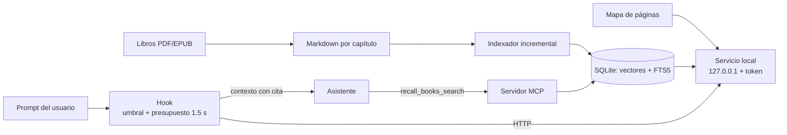

# recall: búsqueda semántica local sobre una biblioteca técnica bilingüe

**Autor:** Andrés
**Fecha:** 2026-11-05

## Resumen

recall es un sistema de recuperación local que pone una biblioteca de 126 libros técnicos en inglés al alcance de un asistente de programación (Claude Code y Claude Desktop), con preguntas escritas en español. Funciona sin servicios externos: un índice SQLite con vectores y texto completo, un modelo de embeddings ONNX ejecutado en la GPU local, un hook que inyecta fragmentos solo cuando son pertinentes y un servidor MCP. Lo evaluamos con 80 consultas etiquetadas a mano (40 en español, 40 en inglés) y 28 prompts negativos. El índice de partida recupera el pasaje correcto entre los cinco primeros en el 97.5 % de las consultas. Cinco experimentos variaron el tamaño de fragmento y el modelo. La combinación de embeddinggemma-2 con fragmentos de ~3 500 caracteres (E5) llega a 98.8 %, reduce el índice de 111 407 a 34 721 fragmentos y es la única configuración, junto con E3, que separa por completo las consultas pertinentes de las ajenas. También documentamos un defecto del ONNX cuantizado de Qwen3-Embedding: su resultado depende del relleno del lote.

## 1. Introducción

El problema es práctico: una persona que trabaja en español consulta a diario una biblioteca de libros técnicos en inglés (arquitectura, datos, SRE, seguridad, nube, pruebas, IA, gestión ágil) y quiere que su asistente de programación cite esos libros en lugar de responder de memoria.

La biblioteca tiene 126 libros: 88 en PDF y 38 en EPUB, convertidos a Markdown por capítulo (3 184 archivos). Las preguntas llegan en español; los libros están en inglés. La búsqueda tiene que cruzar idiomas.

Tres requisitos acotaron el diseño:

- **Local primero.** Todo corre en la máquina del usuario: ni el texto de los libros ni las preguntas salen a un servicio externo.
- **Dos formas de uso.** Una automática, que agrega contexto a cada prompt pertinente sin que el usuario lo pida, y una explícita, que el asistente invoca cuando necesita buscar.
- **No estorbar.** Si la búsqueda falla o tarda, el prompt sigue sin cambios; un fragmento irrelevante inyectado es peor que ninguno.

El tercer requisito resultó el más exigente. La búsqueda explícita solo necesita ordenar bien los resultados. La automática necesita además un **umbral absoluto**: decidir, sin intervención humana, si el mejor resultado es lo bastante bueno para inyectarlo.

## 2. Alternativas evaluadas

El diseño inicial proponía Docling para convertir los libros, qmd como índice y buscador (BM25 + vectores + expansión de consulta + reordenamiento), Qwen3-Embedding como modelo y qmd en modo servidor HTTP.

Antes de construir nada, comparamos qmd con un prototipo propio (recall) usando las mismas consultas. La calidad de recuperación empató. La diferencia estuvo en dos puntos:

1. **Puntajes.** qmd devuelve puntajes basados en posición, útiles para ordenar pero no para decidir si un resultado es pertinente. recall expone el coseno entre consulta y fragmento, que sí admite un umbral absoluto. Esto decidió la elección, porque el hook automático depende de ese umbral.
2. **Operación en Windows.** qmd presentó varios problemas en la máquina de prueba: con dos GPU, el backend Vulkan reportaba 0 B de VRAM libre hasta restringirlo a una sola; el backend CUDA se colgó; el puerto por defecto (8181) cae en un rango que Windows reserva (8100–8199); y el servidor HTTP no tiene autenticación.

Se descartó también un sistema de memoria de conversaciones ya instalado: la biblioteca de libros quedó como un sistema independiente, sin dependencias de ese sistema.

## 3. Sistema

recall tiene cuatro piezas que comparten un mismo índice.

**Índice.** Un archivo SQLite en modo WAL. Cada fragmento guarda su texto, su ubicación (libro, capítulo, sección, líneas), su idioma y su vector como un bloque de float32. Una tabla FTS5 indexa el mismo texto para búsqueda léxica. No hace falta una base de datos vectorial especializada: la matriz de vectores (768 dimensiones) se carga en memoria y se recorre completa en cada búsqueda. Con el índice de producción final (34 721 fragmentos), una búsqueda completa, incluido embeber la consulta, tiene una mediana de 0.13 s.

**Modelo.** Un modelo de embeddings ONNX cuantizado a 8 bits, ejecutado con onnxruntime-directml en la GPU: embeddinggemma-300m en la versión inicial y embeddinggemma-2 tras los experimentos de la sección 5. Consulta y documento llevan los prefijos que pide el modelo (`task: search result | query: …` y `title: … | text: …`).

**Búsqueda híbrida.** El resultado vectorial y el léxico se combinan con fusión por rango recíproco (RRF). El peso léxico es menor cuando la consulta y el libro están en idiomas distintos, porque las palabras no coinciden. Los resultados se deduplican por capítulo y sección.

**Servicio.** Un proceso local (`recall serve`) mantiene el modelo cargado y escucha en 127.0.0.1, en un puerto efímero, con un token Bearer. Un script de inicio (`start-recall.ps1`) lo levanta al abrir una sesión.

**Hook automático** (`recall_hook.py`). Se ejecuta antes de cada prompt. Descarta los triviales o mecánicos ("haz commit", "corre los tests"), busca y, si el mejor coseno supera el umbral, inyecta hasta tres fragmentos con su cita. Tiene un presupuesto de 1.5 s y falla abierto: ante cualquier error o demora, el prompt pasa intacto. Arranca en **modo sombra**: registra lo que habría inyectado (un hash del prompt, nunca su texto) sin inyectar nada, para calibrar el umbral con uso real.

**Servidor MCP.** Expone la herramienta `recall_books_search`, que el asistente invoca con la pregunta en español y en inglés en la misma llamada. Admite filtros por dominio temático (14 dominios) y por año de publicación; 119 de los 126 libros tienen el año verificado en su página de derechos, y los siete restantes quedan sin año en lugar de con uno adivinado.

**Citas con página.** Para los 88 PDF, un mapa relaciona cada línea del Markdown con su página impresa (la numeración del libro, no la del archivo). El 96.1 % de las líneas quedó ubicado de forma exacta; el resto se cita como aproximado (`p. ~N`). Los EPUB se citan por capítulo.

**Garantías del índice.**

- *Identidad del modelo.* El índice guarda la identidad del modelo (nombre, revisión, sha256 de sus archivos, prefijos, troceo). Buscar con otro modelo es un error explícito, no resultados silenciosamente malos.
- *Indexado incremental.* Solo reprocesa capítulos cuyo tamaño, fecha o sha256 cambió, y reutiliza el vector de cualquier texto ya embebido.
- *Escritura atómica por lote.* Cada lote de capítulos y sus fragmentos se graba en una sola transacción: una interrupción pierde, como mucho, el lote en curso.

### Figura 1. Flujo de datos



## 4. Metodología

**Consultas.** 80 consultas sobre 30 temas: 20 heredadas del prototipo y 60 nuevas (archivo `tests/data/queries_books_80.json`). Cada tema tiene una versión en español y otra en inglés. Las nuevas se etiquetaron leyendo los libros (búsqueda de texto y encabezados), sin usar ningún buscador semántico, para no sesgar el conjunto a favor de recall ni de otro motor. Incluyen siglas (ADR, BFF, mTLS, SBOM, CSRF, DORA) y cinco consultas conceptuales que no nombran el término. Se excluyeron temas presentes en más de ocho capítulos (CQRS, sagas, strangler fig) por demasiado genéricos.

**Métricas.**

- **R@5:** parte de las consultas cuyo pasaje correcto aparece entre los cinco primeros.
- **MRR@10:** promedio del inverso de la posición del primer acierto entre los diez primeros (1.0 = siempre primero).
- **Modo hook:** una consulta tal cual la escribe el usuario.
- **Modo MCP:** la pregunta en español y en inglés en la misma llamada.
- **Separación:** parte de los positivos cuyo coseno supera al negativo más alto. Los negativos son 28 prompts ajenos a los libros (por ejemplo, "pon el título del README en negritas") que no descartan los filtros de prompts triviales. Una separación de 1.0 significa que existe un umbral que acepta todos los positivos y rechaza todos los negativos.
- **Latencia:** mediana (p50) y máximo de una búsqueda con el modelo ya cargado.

**Integridad.** Cada índice se revisó con `tools/verify_index.py`, en solo lectura:

1. `quick_check` de SQLite.
2. Contabilidad: los fragmentos declarados por capítulo coinciden con las filas, sin huérfanos.
3. Vectores: largo correcto, valores finitos, norma 1, ninguno en cero.
4. Correspondencia entre texto y vector: el sha256 del texto que se embebió coincide con el guardado.
5. Mismo texto, mismo vector.
6. Una fila de búsqueda léxica por fragmento.
7. Cobertura: cada capítulo de la biblioteca está indexado y sin cambios.

Además, el verificador recalcula una muestra de 30 vectores al azar y exige un coseno ≥ 0.99 con el guardado.

**Experimentos.** Cada configuración se indexó completa en un directorio propio, sin tocar el índice de producción (`experiments/run.ps1`), y se evaluó con `experiments/evaluate.py`.

| Experimento | Modelo | Fragmento (caracteres) |
|---|---|---|
| Producción | embeddinggemma-300m | ~900 (máx. 1 000) |
| E1 | embeddinggemma-300m | ~1 800 (máx. 2 000) |
| E2 | embeddinggemma-300m | ~3 200 (máx. 3 500) |
| E3 | embeddinggemma-2 | ~900 (máx. 1 000) |
| E4 | Qwen3-Embedding-0.6B | ~900 (máx. 1 000) |
| E5 | embeddinggemma-2 | ~3 200 (máx. 3 500) |

## 5. Resultados

Los cinco índices completos pasaron todos los chequeos de integridad, incluido el recálculo de la muestra (coseno 1.00 en todos los casos).

| Índice | Fragmentos | R@5 | R@5 EN→EN | R@5 ES→EN | MRR@10 | R@5 MCP | Separación | Negativo máx. | Positivo mín. |
|---|---|---|---|---|---|---|---|---|---|
| Producción | 111 407 | 0.975 | 0.975 | 0.975 | 0.883 | 0.975 | 0.944 | 0.535 | 0.508 |
| E1 | 55 074 | 0.988 | 1.000 | 0.975 | 0.901 | 1.000 | 0.800 | 0.582 | 0.495 |
| E2 | 34 721 | **1.000** | 1.000 | **1.000** | **0.907** | 1.000 | 0.911 | 0.521 | 0.496 |
| E3 | 111 407 | 0.975 | 0.975 | 0.975 | 0.880 | 1.000 | **1.000** | 0.715 | 0.730 |
| E5 | 34 721 | 0.988 | 1.000 | 0.975 | 0.898 | 1.000 | **1.000** | 0.726 | 0.729 |

**Fragmentos más grandes mejoran la recuperación.** Con el mismo modelo, pasar de ~900 a ~3 500 caracteres sube R@5 de 0.975 a 1.000 y MRR de 0.883 a 0.907, con un índice tres veces más chico. Un fragmento largo conserva el contexto que un párrafo suelto pierde, sobre todo en la consulta cruzada español→inglés (0.975 → 1.000).

**Pero con embeddinggemma-300m degradan la separación.** E1 baja de 0.944 a 0.800: un prompt ajeno alcanza 0.582, por encima del umbral de producción (0.58), y el hook inyectaría texto donde no corresponde. Un vector que promedia más texto se parece un poco a todo.

**embeddinggemma-2 separa por completo.** E3 recupera igual que producción, pero todos sus positivos quedan por encima de todos los negativos. Los cosenos cambian de escala (de ~0.5 a ~0.7), así que el umbral se recalibra por modelo.

**E5 combina ambas mejoras.** Recupera casi como E2 (0.988; la diferencia es una consulta de 80), separa como E3 y tiene la menor latencia medida (p50 0.15 s, máximo 2.03 s). Por eso es la configuración elegida.

La consulta que más falla en todas las configuraciones es B04es ("contexto delimitado"): el término en español no se asocia bien con *bounded context*.

## 6. Hallazgo: Qwen3-Embedding no es invariante al relleno

E4 no llegó a evaluarse. El verificador de integridad lo detuvo: al recalcular vectores de su índice parcial, el coseno con los guardados daba entre 0.88 y 0.92, cuando con los modelos Gemma es exactamente 1.00.

La causa está en el ONNX cuantizado de Qwen3-Embedding-0.6B publicado por onnx-community. Su vector depende del relleno que acompaña al texto en el lote:

| Relleno | CPU | GPU (DirectML) |
|---|---|---|
| A la izquierda, 1 token | 0.939 | — |
| A la izquierda, 20 tokens | 0.923 | — |
| A la derecha, 1–60 tokens | 1.000 | 0.948–0.959 |

*Coseno con el vector del mismo texto sin relleno.*

El modelo original usa relleno a la izquierda y extrae el último token, y así lo configuramos al principio. Con relleno a la derecha el resultado es exacto en CPU, pero no en DirectML. En GPU, entonces, cada vector depende de qué otros textos caen en su lote, y el índice queda con ruido. Además, con lotes de 16 la GPU dejó de responder (error DXGI `887A0006`).

En CPU el modelo funciona bien, pero indexa a 0.7 fragmentos por segundo: unas 46 horas para la biblioteca completa. Lo descartamos en esta máquina.

**Lección.** Antes de indexar con un modelo nuevo, conviene comprobar que su vector no depende del lote: el mismo texto, solo y acompañado, en el mismo dispositivo que se usará en producción. La prueba toma segundos; el indexado, horas.

## 7. Amenazas a la validez

- **Tamaño del conjunto.** Con 80 consultas, cada una vale 1.25 puntos de R@5. Las diferencias entre E2, E5 y producción son de una o dos consultas.
- **Pocos negativos.** La separación se mide con 28 prompts ajenos. En E5 el margen entre el negativo más alto (0.7258) y el positivo más bajo (0.7289) es de 0.003; con más negativos, alguno podría cruzarlo. El umbral definitivo se calibra con el registro del modo sombra.
- **Latencias.** Algunas se midieron mientras otro experimento usaba la GPU. La de E5 se midió con la GPU libre, por lo que su ventaja de velocidad no es concluyente.
- **Un usuario, una máquina.** Las consultas reflejan los temas de una persona, y el hardware es uno solo (Windows 11, una RTX 3070 Ti).
- **Etiquetado.** Una sola persona etiquetó las consultas, sin un segundo revisor.

## 8. Decisión y trabajo futuro

Producción pasa a la configuración E5: embeddinggemma-2 con fragmentos de ~3 500 caracteres. El umbral del hook arranca en 0.75 y se calibra tras una semana de modo sombra con `tools/shadow_report.py`, que muestra cuántos prompts reales se habrían inyectado con cada umbral candidato.

**Recorte del fragmento.** Con fragmentos de 3 500 caracteres y un límite de 700 por fragmento inyectado, inyectar el inicio del fragmento a menudo deja fuera el párrafo pertinente. El servicio parte cada fragmento en hasta seis ventanas por frases y devuelve la que comparte más términos con la pregunta. La primera versión elegía la ventana re-embebiéndolas con el modelo, pero con embeddinggemma-2 en DirectML eso costaba unos 2 s por resultado (6.5–7 s por búsqueda), muy por encima del presupuesto del hook. La versión por términos cuesta milisegundos (0.18–0.21 s por búsqueda con recorte, frente a 0.18 s sin él). Funciona en el cruce español→inglés porque los términos técnicos suelen escribirse igual en ambos idiomas (*bounded context*, *error budget*, SLO). Si no hay coincidencias, usa la primera ventana.

Pendientes:

- Ampliar los negativos de 28 a un centenar, tomados del registro de sombra.
- Añadir un segundo etiquetador para una parte de las consultas.
- Incorporar la prueba de invariancia al lote como chequeo automático antes de indexar.
- Evaluar si el diseño sirve en la nube: el índice es un archivo y el servicio no depende de la máquina, pero el modelo en GPU local sí.

### Despliegue a producción

El 2026-11-05 el índice de E5 reemplazó al de producción. El anterior quedó respaldado, así que revertir es cambiar un directorio. Medido sobre producción ya con E5:

| Conjunto | R@5 total | R@5 EN→EN | R@5 ES→EN | MRR@10 total |
|---|---|---|---|---|
| 80 consultas | 0.988 | 1.000 | 0.975 | 0.898 |
| 20 consultas originales | 0.950 | 1.000 | 0.900 | 0.868 |

Estas cifras son ahora los pisos de los tests de regresión (`tests/test_regression.py` y `tests/test_regression_80.py`): bajar de ellos hace fallar las pruebas.

**Umbral inicial.** Con 0.75 pasan el 96.7 % de los positivos y ninguno de los 28 negativos (negativo máximo 0.726). Se eligió 0.75 y no 0.72 tras una prueba con prompts reales. "Revisa por qué falla el pipeline de GitHub Actions en mi repo" obtuvo 0.73 y habría inyectado un libro de microservicios. En la misma prueba, cuatro preguntas sobre libros encontraron el libro correcto con cosenos de 0.76 a 0.82, y un saludo quedó en 0.66. Con el modelo anterior, una de esas preguntas ("explícame el cono de incertidumbre al estimar") quedaba por debajo de su umbral (0.5585 frente a 0.58).

**Latencia del hook.** De 0.4 a 0.6 s de punta a punta, incluido el arranque del intérprete, dentro del presupuesto de 1.5 s.

**Modo sombra.** Arranca con el modelo nuevo el mismo día. Los registros con el modelo anterior se archivaron aparte, porque sus cosenos están en otra escala y no sirven para calibrar este umbral.

## Apéndice: reproducibilidad

**Entorno.** Windows 11, NVIDIA RTX 3070 Ti, Python 3.12.13, onnxruntime-directml 1.24.4, tokenizers 0.23.1, numpy 2.5.2. Dependencias fijadas con hashes en `requirements.lock`.

**Modelos** (ONNX cuantizado, de onnx-community):

- `embeddinggemma-300m-ONNX`, 768 dimensiones.
- `embeddinggemma-2-ONNX`, 768 dimensiones.
- `Qwen3-Embedding-0.6B-ONNX`, 1 024 dimensiones.

**Comandos** (desde la raíz del repositorio):

```powershell
# indexar (incremental)
.venv\Scripts\python.exe -I -m recall index

# experimentos: cada uno en su propio directorio, en serie
pwsh -File experiments\run.ps1                         # todos
pwsh -File experiments\run.ps1 -Only e5-gemma2-chunk3500

# evaluar producción y experimentos con las 80 consultas
.venv\Scripts\python.exe -I experiments\evaluate.py

# verificar la integridad de un índice (solo lectura)
.venv\Scripts\python.exe -I tools\verify_index.py <directorio> --sample 30

# resumen del modo sombra para calibrar el umbral
.venv\Scripts\python.exe -I tools\shadow_report.py

# pruebas unitarias y de regresión con el índice real
.venv\Scripts\python.exe -I -m pytest
.venv\Scripts\python.exe -I -m pytest -m model
```

**Archivos relevantes.**

- `experiments/configs/` — configuración de cada experimento.
- `tests/data/queries_books_80.json` — las 80 consultas y sus respuestas esperadas.
- `src/recall/evaluation.py` — métricas y prompts negativos.
- `tests/test_regression_80.py` — pisos de regresión.
