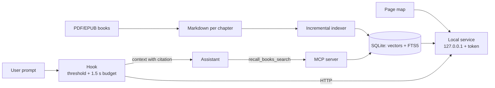

# recall: local semantic search over a bilingual technical library

**Author:** Andrés
**Date:** 2026-11-05

## Abstract

recall is a local retrieval system that makes a library of 126 English-language technical books available to a coding assistant (Claude Code and Claude Desktop) through questions written in Spanish. It runs without external services: a SQLite index holding vectors and full text, an ONNX embedding model running on the local GPU, a hook that injects passages only when they are relevant, and an MCP server. We evaluate it with 80 hand-labeled queries (40 in Spanish, 40 in English) and 28 negative prompts. The baseline index ranks the correct passage in the top five for 97.5 % of the queries. Five experiments varied chunk size and embedding model. Pairing embeddinggemma-2 with ~3,500-character chunks (E5) reaches 98.8 %, shrinks the index from 111,407 to 34,721 chunks, and, together with E3, is the only configuration that fully separates relevant queries from unrelated ones. We also document a defect in the quantized ONNX export of Qwen3-Embedding: its output depends on the padding in the batch.

## 1. Introduction

The problem is practical. A Spanish-speaking engineer consults a library of English technical books every day (architecture, data, SRE, security, cloud, testing, AI, agile management) and wants their coding assistant to cite those books instead of answering from memory.

The library holds 126 books, 88 PDF and 38 EPUB, converted to Markdown one file per chapter (3,184 files). Questions arrive in Spanish while the books are in English, so retrieval must cross languages.

Three requirements shaped the design:

- **Local first.** Everything runs on the user's machine. Neither the book text nor the questions leave it.
- **Two modes of use.** An automatic one that adds context to every relevant prompt without being asked, and an explicit one that the assistant calls when it needs to search.
- **Stay out of the way.** If retrieval fails or is slow, the prompt goes through unchanged. An irrelevant injected passage is worse than none.

The third requirement turned out to be the hardest. Explicit search only needs a good ranking. Automatic injection also needs an **absolute threshold**: deciding, with no human in the loop, whether the best result is good enough to inject. recall therefore exposes the raw cosine similarity between query and chunk rather than a rank-based score, because only the former supports such a threshold.

## 2. System

recall has four components that share one index.

**Index.** A SQLite file in WAL mode. Each chunk stores its text, its location (book, chapter, section, lines), its language and its vector as a float32 blob. An FTS5 table indexes the same text for lexical search. No dedicated vector database is needed: the vector matrix (768 dimensions) is loaded into memory and scanned in full on every query. With the final production index (34,721 chunks), a complete search, including embedding the query, has a median latency of 0.13 s.

**Model.** An 8-bit quantized ONNX embedding model run with onnxruntime-directml on the GPU: embeddinggemma-300m in the initial version and embeddinggemma-2 after the experiments in Section 4. Queries and documents carry the prefixes the model expects (`task: search result | query: …` and `title: … | text: …`).

**Hybrid search.** Vector and lexical results are merged with reciprocal rank fusion (RRF). The lexical weight is lowered when the query and the book are in different languages, since their words do not match. Results are deduplicated by chapter and section.

**Service.** A local process (`recall serve`) keeps the model loaded and listens on 127.0.0.1 on an ephemeral port, protected by a Bearer token. A startup script (`start-recall.ps1`) launches it when a session opens.

**Automatic hook** (`recall_hook.py`). Runs before every prompt. It skips trivial or mechanical prompts ("commit this", "run the tests"), searches, and, if the best cosine clears the threshold, injects up to three passages with their citations. It has a 1.5 s budget and fails open: on any error or delay the prompt passes through untouched. It starts in **shadow mode**, logging what it would have injected (a hash of the prompt, never its text) without injecting anything, so the threshold can be calibrated on real usage.

**MCP server.** Exposes the `recall_books_search` tool, which the assistant calls with the question in both Spanish and English in a single request. It supports filters by topic domain (14 domains) and by publication year. The year is verified against the copyright page for 119 of the 126 books; the remaining seven are left without a year rather than given a guessed one.

**Page citations.** For the 88 PDFs, a map links every Markdown line to its printed page (the book's own numbering, not the file's). 96.1 % of lines are located exactly; the rest are cited as approximate (`p. ~N`). EPUBs are cited by chapter.

**Index guarantees.**

- *Model identity.* The index records the model's identity (name, revision, sha256 of its files, prefixes, chunking). Searching with a different model raises an explicit error instead of returning silently wrong results.
- *Incremental indexing.* Only chapters whose size, timestamp or sha256 changed are reprocessed, and the vector of any text already embedded is reused.
- *Atomic batch writes.* Each batch of chapters and their chunks is committed in a single transaction, so an interruption loses at most the batch in progress.

### Figure 1. Data flow



## 3. Methodology

**Queries.** 80 queries over 30 topics: 20 from an earlier evaluation set and 60 new ones (file `tests/data/queries_books_80.json`). Each topic has a Spanish and an English version. The new queries were labeled by reading the books (text search and headings) without any semantic search engine, so as not to bias the set toward recall. They include acronyms (ADR, BFF, mTLS, SBOM, CSRF, DORA) and five conceptual queries that never name the term. Topics present in more than eight chapters (CQRS, sagas, strangler fig) were excluded as too generic.

**Metrics.**

- **R@5:** share of queries whose correct passage appears in the top five.
- **MRR@10:** mean reciprocal rank of the first hit within the top ten (1.0 = always first).
- **Hook mode:** the query exactly as the user writes it.
- **MCP mode:** the question in Spanish and English in a single request.
- **Separation:** share of positives whose cosine exceeds the highest negative. The negatives are 28 prompts unrelated to the books (for example, "make the README title bold") that the trivial-prompt filters do not discard. A separation of 1.0 means some threshold accepts every positive and rejects every negative.
- **Latency:** median (p50) and maximum of one search with the model already loaded.

**Integrity.** Every index was checked read-only with `tools/verify_index.py`:

1. SQLite `quick_check`.
2. Accounting: the chunks declared per chapter match the rows, with no orphans.
3. Vectors: correct length, finite values, unit norm, none all-zero.
4. Text–vector correspondence: the sha256 of the embedded input matches the stored one.
5. Same text, same vector.
6. One lexical-search row per chunk.
7. Coverage: every chapter in the library is indexed and unchanged.

The verifier also re-embeds a random sample of 30 chunks and requires a cosine ≥ 0.99 with the stored vector.

**Experiments.** Each configuration was fully indexed into its own directory, leaving the production index untouched (`experiments/run.ps1`), and evaluated with `experiments/evaluate.py`.

| Experiment | Model | Chunk size (characters) |
|---|---|---|
| Baseline | embeddinggemma-300m | ~900 (max 1,000) |
| E1 | embeddinggemma-300m | ~1,800 (max 2,000) |
| E2 | embeddinggemma-300m | ~3,200 (max 3,500) |
| E3 | embeddinggemma-2 | ~900 (max 1,000) |
| E4 | Qwen3-Embedding-0.6B | ~900 (max 1,000) |
| E5 | embeddinggemma-2 | ~3,200 (max 3,500) |

## 4. Results

All five complete indexes passed every integrity check, including the re-embedded sample (cosine 1.00 in every case).

| Index | Chunks | R@5 | R@5 EN→EN | R@5 ES→EN | MRR@10 | R@5 MCP | Separation | Max negative | Min positive |
|---|---|---|---|---|---|---|---|---|---|
| Baseline | 111,407 | 0.975 | 0.975 | 0.975 | 0.883 | 0.975 | 0.944 | 0.535 | 0.508 |
| E1 | 55,074 | 0.988 | 1.000 | 0.975 | 0.901 | 1.000 | 0.800 | 0.582 | 0.495 |
| E2 | 34,721 | **1.000** | 1.000 | **1.000** | **0.907** | 1.000 | 0.911 | 0.521 | 0.496 |
| E3 | 111,407 | 0.975 | 0.975 | 0.975 | 0.880 | 1.000 | **1.000** | 0.715 | 0.730 |
| E5 | 34,721 | 0.988 | 1.000 | 0.975 | 0.898 | 1.000 | **1.000** | 0.726 | 0.729 |

**Larger chunks improve retrieval.** With the same model, going from ~900 to ~3,500 characters raises R@5 from 0.975 to 1.000 and MRR from 0.883 to 0.907, with an index one third the size. A long chunk keeps context that an isolated paragraph loses, especially in the cross-lingual Spanish→English case (0.975 → 1.000).

**With embeddinggemma-300m, however, they hurt separation.** E1 drops from 0.944 to 0.800: an unrelated prompt reaches 0.582, above the baseline threshold (0.58), so the hook would inject text where it does not belong. A vector that averages more text looks a little like everything.

**embeddinggemma-2 separates completely.** E3 retrieves as well as the baseline, but every positive scores above every negative. Cosines shift in scale (from ~0.5 to ~0.7), so the threshold must be recalibrated per model.

**E5 combines both gains.** It retrieves almost as well as E2 (0.988; the gap is one query out of 80), separates like E3, and has the lowest measured latency (p50 0.15 s, max 2.03 s). That is why it was chosen.

The query that fails most across configurations is B04es ("contexto delimitado"): the Spanish term does not map well to *bounded context*.

## 5. Finding: Qwen3-Embedding is not padding-invariant

E4 was never evaluated. The integrity verifier stopped it: re-embedding chunks from its partial index gave cosines of 0.88–0.92 against the stored vectors, where the Gemma models give exactly 1.00.

The cause lies in the quantized ONNX export of Qwen3-Embedding-0.6B published by onnx-community. Its vector depends on the padding that accompanies the text in the batch:

| Padding | CPU | GPU (DirectML) |
|---|---|---|
| Left, 1 token | 0.939 | — |
| Left, 20 tokens | 0.923 | — |
| Right, 1–60 tokens | 1.000 | 0.948–0.959 |

*Cosine against the vector of the same text without padding.*

The original model uses left padding and last-token pooling, which is how we first configured it. With right padding the result is exact on CPU but not on DirectML. On the GPU, then, each vector depends on which other texts share its batch, and the index ends up noisy. In addition, with batches of 16 the GPU stopped responding (DXGI error `887A0006`).

On CPU the model works correctly but indexes at 0.7 chunks per second, about 46 hours for the whole library. We ruled it out on this machine.

**Lesson.** Before indexing with a new model, check that its vector does not depend on the batch: embed the same text alone and alongside others, on the same device that production will use. The test takes seconds; indexing takes hours.

## 6. Threats to validity

- **Set size.** With 80 queries, each one is worth 1.25 points of R@5. The differences between E2, E5 and the baseline amount to one or two queries.
- **Few negatives.** Separation is measured with 28 unrelated prompts. In E5 the margin between the highest negative (0.7258) and the lowest positive (0.7289) is 0.003; with more negatives, one could cross it. The final threshold is calibrated from the shadow-mode log.
- **Latency.** Some latencies were measured while another experiment was using the GPU. E5's was measured with the GPU idle, so its speed advantage is not conclusive.
- **One user, one machine.** The queries reflect one person's topics, and there is a single hardware setup (Windows 11, an RTX 3070 Ti).
- **Labeling.** A single person labeled the queries, with no second reviewer.

## 7. Decision and future work

Production moves to configuration E5: embeddinggemma-2 with ~3,500-character chunks. The hook threshold starts at 0.75 and is calibrated after a week of shadow mode with `tools/shadow_report.py`, which shows how many real prompts would have been injected at each candidate threshold.

**Passage trimming.** With 3,500-character chunks and a 700-character limit per injected passage, injecting the start of the chunk often leaves out the relevant paragraph. The service splits each chunk into up to six sentence-aligned windows and returns the one sharing the most terms with the question. The first version picked the window by re-embedding the windows with the model, but with embeddinggemma-2 on DirectML that cost about 2 s per result (6.5–7 s per search), far above the hook's budget. The term-based version costs milliseconds (0.18–0.21 s per search with trimming, versus 0.18 s without). It works across Spanish→English because technical terms are usually written the same in both languages (*bounded context*, *error budget*, SLO). With no matches, it falls back to the first window.

Open items:

- Grow the negatives from 28 to about a hundred, drawn from the shadow log.
- Add a second labeler for part of the queries.
- Make the batch-invariance test an automatic check before indexing.
- Assess whether the design works in the cloud: the index is a single file and the service is machine-independent, but the local-GPU model is not.

### Production rollout

On 2026-11-05 the E5 index replaced the production one. The previous index was kept as a backup, so reverting means swapping a directory. Measured on production after the switch:

| Set | R@5 total | R@5 EN→EN | R@5 ES→EN | MRR@10 total |
|---|---|---|---|---|
| 80 queries | 0.988 | 1.000 | 0.975 | 0.898 |
| Original 20 queries | 0.950 | 1.000 | 0.900 | 0.868 |

These figures are now the floors of the regression tests (`tests/test_regression.py` and `tests/test_regression_80.py`): falling below them fails the suite.

**Initial threshold.** At 0.75, 96.7 % of positives pass and none of the 28 negatives do (max negative 0.726). 0.75 was chosen over 0.72 after a test with real prompts. "Check why the GitHub Actions pipeline fails in my repo" scored 0.73 and would have injected a microservices book. In the same test, four questions about the books found the right book with cosines of 0.76–0.82, and a greeting scored 0.66. With the previous model, one of those questions ("explain the cone of uncertainty in estimation") fell below its threshold (0.5585 vs 0.58).

**Hook latency.** 0.4–0.6 s end to end, including interpreter startup, within the 1.5 s budget.

**Shadow mode.** Restarted with the new model the same day. Logs from the previous model were archived separately, since their cosines are on a different scale and cannot calibrate this threshold.

## Appendix: reproducibility

**Environment.** Windows 11, NVIDIA RTX 3070 Ti, Python 3.12.13, onnxruntime-directml 1.24.4, tokenizers 0.23.1, numpy 2.5.2. Dependencies pinned with hashes in `requirements.lock`.

**Models** (quantized ONNX, from onnx-community):

- `embeddinggemma-300m-ONNX`, 768 dimensions.
- `embeddinggemma-2-ONNX`, 768 dimensions.
- `Qwen3-Embedding-0.6B-ONNX`, 1,024 dimensions.

**Commands** (from the repository root):

```powershell
# index (incremental)
.venv\Scripts\python.exe -I -m recall index

# experiments: each in its own directory, run in sequence
pwsh -File experiments\run.ps1                         # all
pwsh -File experiments\run.ps1 -Only e5-gemma2-chunk3500

# evaluate production and experiments on the 80 queries
.venv\Scripts\python.exe -I experiments\evaluate.py

# verify an index's integrity (read-only)
.venv\Scripts\python.exe -I tools\verify_index.py <directory> --sample 30

# shadow-mode summary for threshold calibration
.venv\Scripts\python.exe -I tools\shadow_report.py

# unit tests and regression tests against the real index
.venv\Scripts\python.exe -I -m pytest
.venv\Scripts\python.exe -I -m pytest -m model
```

**Relevant files.**

- `experiments/configs/` — configuration of each experiment.
- `tests/data/queries_books_80.json` — the 80 queries and their expected answers.
- `src/recall/evaluation.py` — metrics and negative prompts.
- `tests/test_regression_80.py` — regression floors.
